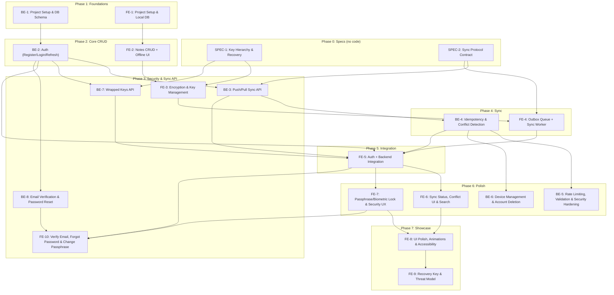

# CryptoNote – Feature Tickets & Implementation Plan (Rev 2)

> Derived from [Crypto Note – PRD (Frontend & Backend).md](file:///d:/KotlinAps/CryptoNote/Crypto%20Note%20%E2%80%93%20PRD%20%28Frontend%20%26%20Backend%29.md)

## Revision 2 – What Changed

| #   | Fix                                                                                                                                                             | Tickets touched                        |
| --- | --------------------------------------------------------------------------------------------------------------------------------------------------------------- | -------------------------------------- |
| 1   | **Separate login password** for v1. Encryption passphrase never leaves the device. HKDF auth-key split moved to v2.                                             | BE-1, BE-2, FE-3, FE-5                 |
| 2   | **Key hierarchy defined first**: random master key (MK), wrapped by passphrase-KEK, recovery key and Android Keystore. Wrapped blobs stored on server.          | **SPEC-1**, **BE-7**, FE-3, FE-5, FE-9 |
| 3   | **Pull cursor fixed**: per-user counter replaces `BIGSERIAL`, so sequence order equals commit order.                                                            | BE-1, BE-3                             |
| 4   | **Version / AAD contract**: client proposes `version = base_version + 1`, server enforces it.                                                                   | **SPEC-2**, BE-3, FE-3                 |
| 5   | **Idempotency race fixed**: insert-first with unique constraint; no pruning in v1.                                                                              | BE-1, BE-4                             |
| 6   | **Outbox ordering**: local sequence key, per-note ordering, ack-only completion.                                                                                | FE-1, FE-4                             |
| 7   | Conflict copy re-encrypted and enqueued; pull + cursor in one transaction; canonical serialization; recovery tested on clean install; metadata in threat model. | FE-3, FE-4, FE-6, FE-9                 |
| 8   | New spec tickets **SPEC-1** and **SPEC-2** scheduled before FE-3, FE-4 and BE-3.                                                                                | Order table, dependency map            |
| 9   | **Version removed from the AAD** (decryption failures after edits/sync). Legacy reader plus rollback guard on the client.                                       | SPEC-2, FE-3                           |

---

## Execution Order & Dependency Map



---

# 🟣 SPEC TICKETS (design only, no app code)

---

## SPEC-1: Key Hierarchy & Recovery

| Field          | Value                  |
| -------------- | ---------------------- |
| **Priority**   | P0                     |
| **Estimate**   | 1 day                  |
| **Depends On** | None                   |
| **Blocks**     | FE-3, BE-7, FE-5, FE-9 |
| **PRD Refs**   | F3, F4, F10, A3, B6    |

### Description

Define one key hierarchy before any crypto code is written. Output: `docs/KEY_HIERARCHY.md` with a diagram and the flows below.

### Decisions (fixed for v1)

- **Login password** and **encryption passphrase** are separate secrets. The login password goes to the server over TLS (Argon2id-hashed server-side). The passphrase never leaves the device.
- **Master key (MK):** random 256-bit, generated on device with `SecureRandom`. It is **not** derived from the passphrase.
- **Passphrase wrap:** `KEK = Argon2id(passphrase, pass_salt)`; `pass_wrapped_mk = AES-256-GCM(KEK, MK)`.
- **Recovery wrap:** random 256-bit recovery key; `recovery_wrapped_mk = AES-256-GCM(recovery_key, MK)`.
- **Device wrap:** Android Keystore key wraps MK locally (fast and biometric unlock).
- **Note key:** `note_key = HKDF-SHA256(MK, info="note-enc-v1")`.
- **Server stores** `pass_wrapped_mk`, `pass_salt`, KDF params and `recovery_wrapped_mk` as opaque blobs. It cannot unwrap them.

### Acceptance Criteria

- [x] Diagram showing MK, KEK, recovery key, Keystore key, note key and where each is stored
- [x] Flow documented: **first setup**
- [x] Flow documented: **normal unlock** (passphrase and biometric)
- [x] Flow documented: **new-device recovery** (log in → fetch blobs → passphrase **or** recovery key → MK)
- [x] Flow documented: **passphrase change** (re-wrap MK only; notes untouched)
- [x] Flow documented: **device loss** (no Keystore needed; recovery via server blobs)
- [x] Wrapped-key blob format specified (version byte, nonce, ciphertext, KDF params)
- [x] v2 items listed: HKDF auth-key split (zero-knowledge login), MK rotation

---

## SPEC-2: Sync Protocol Contract

| Field          | Value      |
| -------------- | ---------- |
| **Priority**   | P0         |
| **Estimate**   | 1 day      |
| **Depends On** | None       |
| **Blocks**     | BE-3, FE-4 |
| **PRD Refs**   | B2, B3, A6 |
| **Status**     | Completed  |

### Description

Define the sync contract before BE-3 and FE-4. Output: `docs/SYNC_PROTOCOL.md` and `docs/SYNC_REVISION_2_FIX_AND_IMPLEMENTATION.md`.

### Decisions (fixed for v1)

- **Version rule:** client proposes `version = base_version + 1` (create: `base_version = 0`, `version = 1`). Server accepts only if `base_version` equals the stored version, and stores `version` as sent. The version is sync metadata only. It is **not** part of the AES-GCM AAD, so coalescing, conflict copies and pulls can never break decryption.
- **Cursor:** per-user counter `user_sync.last_seq`, incremented inside the push transaction. Pull returns `seq > cursor` in order. A returned `seq` implies all lower `seq` values are committed.
- **Op lifecycle:** `pending → sent (server ack: applied/duplicate) | conflict | failed`. Only a server ack completes an op.
- **Ordering:** ops are pushed in local `seq` order; ops for the same note are strictly ordered; a failed op blocks later ops for that note only.
- **Conflict protocol:** server returns `conflict` + `server_version`. Client pulls the server copy, saves its own edit as a **new note** (new UUID, re-encrypted, version 1, `create` op), and applies the server version to the original.
- **Idempotency:** `op_id` is unique per user. Retries return the stored result.
- **Tombstones:** deletes are `version + 1` with `deleted = true`; no ciphertext required.

### Acceptance Criteria

- [x] Request/response JSON examples for push and pull
- [x] State diagram of the op lifecycle
- [x] Sequence diagram for conflict resolution
- [x] Error codes and retry rules (which statuses retry, which fail permanently)
- [x] Limits documented (1 MB per note, 100 ops per push, 100 changes per pull)

---

# 🔵 BACKEND TICKETS (Node.js)

---

## BE-1: Project Setup & Database Schema

| Field          | Value                            |
| -------------- | -------------------------------- |
| **Priority**   | P0                               |
| **Estimate**   | 1–2 days                         |
| **Depends On** | None                             |
| **PRD Refs**   | B4 (Data Model), B5 (Tech Stack) |

### Description

Bootstrap the Node.js backend project and set up the PostgreSQL database with all required tables.

### Acceptance Criteria

- [ ] Project initialized with **TypeScript + Node.js**
- [ ] **Fastify** (or Express) configured with project structure: `routes/`, `services/`, `middleware/`, `db/`, `utils/`
- [ ] **Prisma** ORM configured with PostgreSQL connection
- [ ] Database schema created with these tables:

#### Tables

**`users`**
| Column | Type | Notes |
|--------|------|-------|
| id | UUID | PK, default gen |
| email | VARCHAR(255) | UNIQUE, NOT NULL |
| password_hash | TEXT | Argon2id hash of the **login password** (salt embedded) |
| created_at | TIMESTAMPTZ | DEFAULT now() |

**`user_sync`** _(new: commit-ordered cursor)_
| Column | Type | Notes |
|--------|------|-------|
| user_id | UUID | PK, FK → users |
| last_seq | BIGINT | DEFAULT 0, incremented per applied change |

**`notes`**
| Column | Type | Notes |
|--------|------|-------|
| id | UUID | PK |
| user_id | UUID | FK → users, NOT NULL |
| ciphertext | BYTEA | Encrypted blob (NULL for tombstone) |
| nonce | BYTEA | Unique per save (NULL for tombstone) |
| version | INT | Client-proposed, server-enforced (`base_version + 1`) |
| deleted | BOOLEAN | DEFAULT false (tombstone) |
| updated_at | TIMESTAMPTZ | Auto-updated |
| server_seq | BIGINT | Assigned from `user_sync.last_seq`; UNIQUE (user_id, server_seq) |

**`processed_ops`**
| Column | Type | Notes |
|--------|------|-------|
| op_id | UUID | PK (idempotency key) |
| user_id | UUID | FK → users |
| result | VARCHAR(20) | applied / conflict |
| server_version | INT | Stored so replays return the same answer |
| created_at | TIMESTAMPTZ | DEFAULT now() |

**`refresh_tokens`**
| Column | Type | Notes |
|--------|------|-------|
| id | UUID | PK |
| user_id | UUID | FK → users |
| token_hash | TEXT | SHA-256 of token |
| expires_at | TIMESTAMPTZ | |
| revoked | BOOLEAN | DEFAULT false |

**`wrapped_keys`** _(new; see BE-7)_
| Column | Type | Notes |
|--------|------|-------|
| user_id | UUID | PK, FK → users |
| pass_wrapped_mk | BYTEA | Opaque blob |
| pass_salt | BYTEA | Argon2id salt |
| kdf_params | JSONB | memory, iterations, parallelism |
| recovery_wrapped_mk | BYTEA | Opaque blob |
| key_version | INT | DEFAULT 1 |
| updated_at | TIMESTAMPTZ | |

**`devices`**
| Column | Type | Notes |
|--------|------|-------|
| id | UUID | PK |
| user_id | UUID | FK → users |
| last_seen | TIMESTAMPTZ | |

- [ ] Prisma migration runs successfully
- [ ] Seed script with test data
- [ ] Environment config (`.env.example`) for `DATABASE_URL`, `JWT_SECRET`, `PORT`
- [ ] Docker Compose file for local PostgreSQL
- [ ] Jest test framework configured

### Implementation Plan

```
1. mkdir backend && cd backend
2. npm init -y && install deps:
   - fastify, @fastify/cors, @fastify/helmet
   - prisma, @prisma/client
   - typescript, ts-node, @types/node
   - jest, ts-jest
3. Configure tsconfig.json (strict mode)
4. npx prisma init → configure schema.prisma
5. Define all tables in schema.prisma
6. Add indexes/constraints:
   - UNIQUE notes(user_id, server_seq)
   - processed_ops(user_id)
7. npx prisma migrate dev --name init
8. Create folder structure:
   backend/
   ├── src/
   │   ├── app.ts           (Fastify instance + plugin registration)
   │   ├── server.ts         (entry point)
   │   ├── routes/
   │   ├── services/
   │   ├── middleware/
   │   ├── db/
   │   │   └── prisma.ts     (singleton client)
   │   ├── utils/
   │   └── types/
   ├── prisma/
   │   └── schema.prisma
   ├── tests/
   ├── docker-compose.yml
   └── .env.example
9. Create health-check route: GET /health
10. Write a basic smoke test
```

---

## BE-2: Authentication (Register / Login / Refresh)

| Field          | Value                              |
| -------------- | ---------------------------------- |
| **Priority**   | P0                                 |
| **Estimate**   | 2–3 days                           |
| **Depends On** | BE-1                               |
| **PRD Refs**   | B1, B2 (Functional), B6 (Security) |

### Description

Implement user registration, login, and JWT token refresh. Passwords hashed with Argon2id. The login password is **separate** from the encryption passphrase, which the server never receives.

### Acceptance Criteria

- [ ] `POST /auth/register` – accepts `{ email, password }`, returns `{ userId, accessToken, refreshToken }`; creates the `user_sync` row (`last_seq = 0`)
- [ ] `POST /auth/login` – validates credentials, returns JWT pair
- [ ] `POST /auth/refresh` – accepts `{ refreshToken }`, rotates, returns new JWT pair
- [ ] Passwords hashed with **Argon2id** (argon2 npm package)
- [ ] Access token expires in 15 min; refresh token in 7 days
- [ ] Refresh tokens stored hashed in `refresh_tokens` (revocable, rotated on use)
- [ ] **Zod** validation on all request bodies
- [ ] Auth middleware extracts & verifies JWT, attaches `userId` to request
- [ ] Rate limiting on auth endpoints (5 req/min per IP)
- [ ] No sensitive data in JWT payload (only `userId`, `iat`, `exp`)
- [ ] Unit tests for register, login, refresh, expired token, invalid token, reused refresh token

### Implementation Plan

```
1. Install: argon2, jsonwebtoken, zod, @fastify/rate-limit
2. Create schemas:
   - src/schemas/auth.schema.ts (Zod: RegisterInput, LoginInput, RefreshInput)
3. Create service:
   - src/services/auth.service.ts
     - register(email, password) → Argon2id hash, insert user + user_sync row, gen tokens
     - login(email, password) → verify hash, gen tokens
     - refresh(refreshToken) → verify hash in DB, revoke old, issue new pair
     - generateTokens(userId) → { accessToken, refreshToken }
4. Create routes:
   - src/routes/auth.routes.ts → POST /register, /login, /refresh
5. Create middleware:
   - src/middleware/auth.middleware.ts → verifyToken, attachUser
6. Wire rate limiting on auth routes
7. Tests:
   - tests/auth.test.ts → happy paths + edge cases
```

---

## BE-3: Push/Pull Sync API

| Field          | Value                        |
| -------------- | ---------------------------- |
| **Priority**   | P0                           |
| **Estimate**   | 3–4 days                     |
| **Depends On** | BE-2, SPEC-2                 |
| **PRD Refs**   | B2, B3 (Push/Pull), B3 (API) |

### Description

Implement the core sync endpoints: batch push (create/update/delete operations) and cursor-based pull, following `docs/SYNC_PROTOCOL.md`.

### Acceptance Criteria

- [ ] `POST /sync/push` – accepts array of operations:
  ```json
  [
    {
      "op_id": "uuid",
      "note_id": "uuid",
      "type": "create | update | delete",
      "base_version": 0,
      "version": 1,
      "ciphertext": "base64 (omitted for delete)",
      "nonce": "base64 (omitted for delete)"
    }
  ]
  ```
- [ ] Returns per-op result: `[{ op_id, result: "applied" | "conflict" | "duplicate", server_version }]`
- [ ] `GET /sync/pull?since=<cursor>&limit=100` – returns:
  ```json
  {
    "changes": [{ "id", "ciphertext", "nonce", "version", "deleted", "updated_at", "server_seq" }],
    "next_cursor": 12345,
    "has_more": false
  }
  ```
- [ ] All queries scoped by authenticated `user_id`
- [ ] **Version rule:** `create` requires `base_version = 0, version = 1`; `update`/`delete` require `base_version` = stored version and `version = base_version + 1`; otherwise `conflict`
- [ ] **Cursor rule:** each applied change gets `server_seq` from `UPDATE user_sync SET last_seq = last_seq + 1 WHERE user_id = ? RETURNING last_seq` **inside the same transaction** as the note write (row lock makes sequence order equal commit order)
- [ ] Push batch processed in order within one DB transaction
- [ ] Max payload size enforced: 1 MB per note, 100 ops per push
- [ ] Unit tests: single create, batch push, pull with cursor, pull pagination
- [ ] **Overlapping-transaction test:** two concurrent pushes by the same user while a client paginates pulls; no change is ever skipped

### Implementation Plan

```
1. Create schemas:
   - src/schemas/sync.schema.ts (Zod: PushOperation, PushRequest, PullQuery)
2. Create service:
   - src/services/sync.service.ts
     - push(userId, operations[]) → one transaction:
       a. For each op in order: apply version rule (see BE-4 for idempotency)
       b. On applied: next seq = UPDATE user_sync ... RETURNING last_seq
          write note with that server_seq
       c. Return results array
     - pull(userId, since, limit) →
       SELECT notes WHERE user_id AND server_seq > since
       ORDER BY server_seq LIMIT limit+1
       → derive has_more, next_cursor
3. Create routes:
   - src/routes/sync.routes.ts → POST /sync/push, GET /sync/pull
   - Both require auth middleware
4. Add request size limit (1 MB per note, 100 ops per push)
5. Tests:
   - tests/sync.test.ts → create, update, delete, pull, pagination
   - tests/cursor.test.ts → overlapping transactions + paginated pulls
```

---

## BE-4: Idempotency & Conflict Detection

| Field          | Value                                |
| -------------- | ------------------------------------ |
| **Priority**   | P0                                   |
| **Estimate**   | 2 days                               |
| **Depends On** | BE-3                                 |
| **PRD Refs**   | B4, B5 (Functional), B8 (Acceptance) |

### Description

Make the push endpoint safely retryable (same `op_id` = same result, even under concurrency) and enforce optimistic-concurrency conflict detection.

### Acceptance Criteria

- [ ] Same `op_id` pushed twice produces identical response, no data change
- [ ] **Two simultaneous requests with the same `op_id`:** exactly one applies, the other returns the stored result
- [ ] `base_version` mismatch returns `conflict` with current `server_version`
- [ ] Concurrent pushes to the same note are serialized (row lock on the note and on `user_sync`)
- [ ] `processed_ops` is **not pruned in v1**. If pruning is added later: retain 90+ days and expire older client outbox ops
- [ ] Integration tests:
  - Push same op_id twice → duplicate
  - Push same op_id concurrently → one applied, one stored result
  - Push with stale version → conflict
  - Two concurrent updates → one succeeds, one conflicts
  - Delete after delete → duplicate/no-op

### Implementation Plan

```
1. Per-op logic inside the push transaction (insert-first):
   a. INSERT INTO processed_ops (op_id, user_id, result, server_version)
      ON CONFLICT (op_id) DO NOTHING RETURNING op_id
      - No row returned → another request owns this op_id:
        SELECT stored result and return it as duplicate
   b. For update/delete: SELECT note ... FOR UPDATE
      - base_version != stored version (or version != base_version + 1)
        → UPDATE processed_ops SET result='conflict', server_version=<current>
        → return conflict
   c. On success: allocate server_seq (BE-3), write note,
      UPDATE processed_ops SET result='applied', server_version=<new>
2. Whole batch runs in one Prisma $transaction
3. Tests:
   - tests/idempotency.test.ts → replay, concurrent duplicate, conflict, concurrent updates
```

---

## BE-5: Rate Limiting, Validation & Security Hardening

| Field          | Value                             |
| -------------- | --------------------------------- |
| **Priority**   | P1                                |
| **Estimate**   | 1–2 days                          |
| **Depends On** | BE-4                              |
| **PRD Refs**   | B8 (Rate Limiting), B6 (Security) |

### Description

Add production-grade security hardening: rate limiting, input validation, helmet headers, payload logging prevention.

### Acceptance Criteria

- [ ] Global rate limit: 100 req/min per IP
- [ ] Auth endpoints: 5 req/min per IP
- [ ] Sync endpoints: 30 req/min per user
- [ ] All request bodies validated with **Zod** (reject malformed early)
- [ ] **Helmet** security headers enabled
- [ ] HTTPS-only enforcement (in production)
- [ ] Never log `ciphertext`, `nonce`, wrapped-key blobs, `password`, or token values
- [ ] CORS configured (restrict origins in production)
- [ ] Error responses use consistent format: `{ error: string, code: string }`
- [ ] Request ID middleware for tracing

### Implementation Plan

```
1. Configure @fastify/rate-limit with per-route overrides
2. Ensure all routes have Zod validation (review each route)
3. Add sanitized logger (redact sensitive fields from request logs)
4. Configure Helmet via @fastify/helmet
5. Add CORS plugin with configurable origins
6. Create error handler middleware with consistent error shape
7. Add request-id middleware (use crypto.randomUUID)
8. Review all error paths for information leakage
```

---

## BE-6: Device Management & Account Deletion

| Field          | Value               |
| -------------- | ------------------- |
| **Priority**   | P1                  |
| **Estimate**   | 1–2 days            |
| **Depends On** | BE-4                |
| **PRD Refs**   | B7, B9 (Functional) |

### Description

Allow users to register devices and completely delete their account.

### Acceptance Criteria

- [ ] `POST /devices/register` – register a device (id, push token optional)
- [ ] `GET /devices` – list user's devices with last_seen
- [ ] Device `last_seen` updated on every authenticated request (async, non-blocking)
- [ ] `DELETE /account` – permanently deletes: user, `user_sync`, notes, `processed_ops`, `refresh_tokens`, `wrapped_keys`, devices
- [ ] Account deletion requires re-authentication (login password in body)
- [ ] Returns 204 on success
- [ ] Unit tests for device CRUD and account wipe (verify every table is empty for the user)

### Implementation Plan

```
1. Create schemas: src/schemas/device.schema.ts
2. Create service: src/services/device.service.ts
   - register(userId, deviceId)
   - list(userId)
   - updateLastSeen(userId, deviceId) [called from auth middleware]
3. Create routes: src/routes/device.routes.ts
4. Create service: src/services/account.service.ts
   - deleteAccount(userId, password) → verify password, then CASCADE delete
5. Create route: DELETE /account in src/routes/account.routes.ts
6. Tests: device registration, listing, account deletion cascade
```

---

## BE-7: Wrapped Keys API _(new)_

| Field          | Value        |
| -------------- | ------------ |
| **Priority**   | P0           |
| **Estimate**   | 1 day        |
| **Depends On** | BE-2, SPEC-1 |
| **PRD Refs**   | F10, B6      |

### Description

Store and serve the opaque wrapped master-key blobs so a new device can recover the MK after login (passphrase or recovery key). The server never sees the passphrase, recovery key or MK.

### Acceptance Criteria

- [ ] `PUT /keys` – upsert `{ pass_wrapped_mk, pass_salt, kdf_params, recovery_wrapped_mk, key_version }` (base64 blobs, size-limited)
- [ ] `GET /keys` – returns the caller's blobs; 404 if none
- [ ] Scoped by authenticated `user_id`; rate limited
- [ ] Blobs never logged
- [ ] Passphrase change = `PUT /keys` with new `pass_wrapped_mk` and `pass_salt` only (notes unaffected)
- [ ] Tests: upsert, fetch, cross-user isolation, oversized payload rejected

### Implementation Plan

```
1. Zod schema: src/schemas/keys.schema.ts
2. Service: src/services/keys.service.ts (upsert, get)
3. Routes: src/routes/keys.routes.ts → PUT /keys, GET /keys
4. Tests: tests/keys.test.ts
```

---

# 🟢 FRONTEND TICKETS (Kotlin / Android)

---

## FE-1: Project Setup & Local Database

| Field          | Value                            |
| -------------- | -------------------------------- |
| **Priority**   | P0                               |
| **Estimate**   | 1–2 days                         |
| **Depends On** | None                             |
| **PRD Refs**   | A4 (Tech Stack), A5 (Data Model) |

### Description

Bootstrap the Android project with Jetpack Compose, Hilt DI, Room database, and the MVVM architecture.

### Acceptance Criteria

- [ ] Android project created with **min SDK 26**, target SDK 34
- [ ] **Jetpack Compose** configured with Material 3
- [ ] **Hilt** dependency injection configured
- [ ] **Room** database with these entities:

#### Room Entities

**`NoteEntity`**
| Field | Type | Notes |
|-------|------|-------|
| id | String (UUID) | PK |
| ciphertext | ByteArray | Encrypted content |
| nonce | ByteArray | Per-save nonce |
| version | Int | Default 1; always `previous + 1` on save |
| updatedAt | Long | Epoch millis |
| deleted | Boolean | Tombstone flag |
| syncStatus | String | `pending` / `synced` / `failed` |
| conflictGroupId | String? | Null unless part of a conflict (FE-6) |

**`OutboxEntity`**
| Field | Type | Notes |
|-------|------|-------|
| seq | Long | PK, autoGenerate (deterministic local order) |
| opId | String (UUID) | UNIQUE |
| noteId | String (UUID) | FK |
| type | String | `create` / `update` / `delete` |
| baseVersion | Int | Version the edit was based on |
| version | Int | Proposed new version |
| payload | String | JSON blob (ciphertext + nonce, base64) |
| attempts | Int | Default 0 |
| status | String | `pending` / `sent` / `conflict` / `failed` |
| createdAt | Long | Epoch millis (informational only) |

**`SyncStateEntity`**
| Field | Type | Notes |
|-------|------|-------|
| id | Int | PK (always 1, singleton) |
| lastPullCursor | Long | Server seq cursor |

- [ ] DAOs with basic CRUD operations
- [ ] Database migration strategy set up
- [ ] Project compiles and runs with empty UI
- [ ] Package structure follows clean architecture

### Implementation Plan

```
Project package structure:
  com.cryptonote/
  ├── di/                  (Hilt modules)
  ├── data/
  │   ├── local/
  │   │   ├── db/          (Room DB, entities, DAOs)
  │   │   └── preferences/ (DataStore)
  │   ├── remote/          (Retrofit API)
  │   └── repository/
  ├── domain/
  │   ├── model/           (Domain models)
  │   ├── repository/      (Repository interfaces)
  │   └── usecase/
  ├── presentation/
  │   ├── ui/
  │   │   ├── theme/       (Material 3 theme)
  │   │   ├── notes/       (Notes list screen)
  │   │   ├── editor/      (Note editor screen)
  │   │   └── auth/        (Login/register screens)
  │   └── viewmodel/
  ├── security/            (Crypto, Keystore)
  ├── sync/                (WorkManager, sync logic)
  └── util/

Steps:
1. Create project in Android Studio or via gradle init
2. Add dependencies to build.gradle.kts:
   - Compose BOM, Material3, Navigation
   - Room + KSP, Hilt + KSP
   - Coroutines, Flow
   - Retrofit, OkHttp, Moshi/Kotlinx.serialization
   - WorkManager
3. Configure Hilt: @HiltAndroidApp, DatabaseModule, NetworkModule
4. Define Room entities, DAOs, and Database class
5. Create domain models (Note, SyncStatus enum)
6. Set up Material 3 theme (colors, typography)
7. Verify build + empty Compose screen renders
```

---

## FE-2: Notes CRUD + Offline-First UI

| Field          | Value                                    |
| -------------- | ---------------------------------------- |
| **Priority**   | P0                                       |
| **Estimate**   | 3–4 days                                 |
| **Depends On** | FE-1                                     |
| **PRD Refs**   | F1, F2 (Functional), A7 (Non-Functional) |

### Description

Build the notes list and editor screens with full offline CRUD. All operations write to the local Room database immediately; no network required. UI updates via Flow are instant (< 100 ms target).

### Acceptance Criteria

- [ ] **Notes List Screen:**
  - Displays all non-deleted notes (title preview + timestamp)
  - Pull-to-refresh gesture (triggers sync later)
  - Swipe to delete with undo snackbar
  - FAB to create new note
  - Empty state illustration
- [ ] **Note Editor Screen:**
  - Title + body text fields
  - Auto-save on back press or after debounce (2 s)
  - New note creates UUID client-side
  - Shows last updated timestamp
- [ ] **Delete:** Soft-delete (tombstone flag)
- [ ] All writes go to Room → UI updates instantly via `Flow<List<Note>>`
- [ ] Local write latency < 100 ms (verified with trace)
- [ ] Repository pattern: `NoteRepository` with `getAll()`, `getById()`, `save()`, `delete()`
- [ ] ViewModels use `StateFlow` for UI state
- [ ] Works entirely in airplane mode
- [ ] ⚠️ **Plaintext storage at this stage is dev-only.** Do not distribute any build before FE-3 lands.

### Implementation Plan

```
1. Create domain models:
   - Note(id, title, body, updatedAt, deleted, syncStatus)

2. Create NoteRepository interface + RoomNoteRepository impl:
   - getAllNotes(): Flow<List<Note>>
   - getNoteById(id): Flow<Note?>
   - saveNote(note): suspend  (insert or update)
   - deleteNote(id): suspend  (soft delete)
   Note: At this stage, store plaintext in Room.
         Encryption layer (FE-3) will wrap this later.

3. Create ViewModels:
   - NotesListViewModel: loads all notes, handles delete
   - NoteEditorViewModel: loads single note, handles save with debounce

4. Build Compose screens:
   - NotesListScreen: LazyColumn, SwipeToDismiss, FAB, EmptyState
   - NoteEditorScreen: TextField for title/body, auto-save

5. Set up Compose Navigation: list → editor (with note ID arg)

6. Wire Hilt: provide Repository, ViewModels

7. Test: create, edit, delete in airplane mode; verify instant UI updates
```

---

## FE-3: Encryption & Key Management

| Field          | Value                                                    |
| -------------- | -------------------------------------------------------- |
| **Priority**   | P0                                                       |
| **Estimate**   | 4–5 days                                                 |
| **Depends On** | FE-2, SPEC-1                                             |
| **PRD Refs**   | F3, F4 (Functional), A3 (Security), Skills: Cryptography |

### Description

Implement the key hierarchy from `docs/KEY_HIERARCHY.md`: random master key (MK) wrapped by a passphrase-derived KEK, a recovery key and Android Keystore; per-note AES-256-GCM encryption with an authenticated version.

### Acceptance Criteria

- [x] **Passphrase setup flow:** first launch → set passphrase (min 8 chars; strength hint)
- [x] **Master key:** random 256-bit via `SecureRandom` (not derived from the passphrase)
- [x] **KEK:** `Argon2id(passphrase, pass_salt)` wraps MK with AES-256-GCM → `pass_wrapped_mk`
- [x] **Note key:** `HKDF-SHA256(MK, info="note-enc-v1")`
- [x] **Per-note encryption:**
  - AES-256-GCM, fresh random 12-byte nonce on **every save**
  - AAD = envelope header || `note_id`; the sync version is **not** in the AAD (envelope v2)
  - Title and body serialized as **canonical JSON** (fixed key order, UTF-8) and encrypted together
- [x] **Device wrap:** MK also wrapped by Android Keystore for fast/biometric unlock
- [x] Wrapped blobs stored in EncryptedSharedPreferences or DataStore
- [x] Sensitive byte arrays zeroed after use
- [x] **CryptoManager** interface:
  - `createMasterKey(): ByteArray`
  - `deriveKek(passphrase, salt, params): ByteArray`
  - `wrapMasterKey(mk, wrappingKey): WrappedKey` / `unwrapMasterKey(wrapped, wrappingKey): ByteArray`
  - `deriveNoteKey(mk): ByteArray`
  - `encryptNote(noteId, plaintextJson, noteKey): EncryptedNote`
  - `decryptNote(noteId, ciphertext, nonce, noteKey): String`
- [x] Repository encrypts before Room write, decrypts on read
- [x] Database dump shows only ciphertext (no plaintext anywhere)
- [x] **Legacy reader:** notes written with the version in the AAD still open (try stored version, then 1 to stored version + 16) and are re-encrypted as v2 on read
- [x] **Rollback guard:** device keeps the highest version seen per note and rejects lower pulled versions
- [x] Unit tests: known-answer vectors, tamper test (wrong AAD / wrong note_id fails); changing the sync version never affects decryption, nonce uniqueness across saves

### Implementation Plan

```
1. Add dependencies:
   - org.signal:argon2 (or com.lambdapioneer.argon2kt)
   - javax.crypto (built-in AES-GCM)

2. Create security/CryptoManager.kt per interface above:
   - Argon2id: timeCost=3, memCost=64MB, parallelism=1 (params stored with blob)
   - encryptNote: nonce = SecureRandom 12 bytes; AAD = header bytes 0-9 + noteId bytes (no version)

3. Create security/KeystoreManager.kt:
   - wrapMk(mk) / unwrapMk(): Keystore-backed AES key
   - Android Keystore alias: "cryptonote_device_key"

4. Create security/KeyStorage.kt:
   - Store device-wrapped MK, pass_wrapped_mk, pass_salt, kdf params
   - isSetup(): Boolean

5. Update NoteRepository:
   - save(): version = previous + 1 → serialize canonical JSON → encrypt → store
   - getAll(): read envelope → decrypt (header gives key_id and format) → deserialize

6. Zero sensitive arrays: ByteArray.fill(0) in finally blocks

7. Tests:
   - CryptoManagerTest → round-trip, KAT vectors, tamper cases
   - KeystoreManagerTest → wrap/unwrap
```

---

## FE-4: Outbox Queue + Sync Worker

| Field          | Value                                                       |
| -------------- | ----------------------------------------------------------- |
| **Priority**   | P0                                                          |
| **Estimate**   | 3–4 days                                                    |
| **Depends On** | FE-3, SPEC-2                                                |
| **PRD Refs**   | F5, F6 (Functional), A6 (Sync Behavior), Skills: Networking |

### Description

Implement the outbox pattern: every note write inserts both the note and an outbox entry in a single Room transaction. A WorkManager worker syncs the outbox when the network is available, following `docs/SYNC_PROTOCOL.md`.

### Acceptance Criteria

- [x] Every `save()` / `delete()` creates an `OutboxEntity` (with `baseVersion` and `version`) in the **same Room transaction** as the note change
- [x] **Ordering:** outbox processed by local `seq` (never by `createdAt`)
- [x] **Per-note order:** ops for the same note are pushed strictly in order; a failed op blocks later ops for that note only
- [x] **Coalescing:** consecutive unsent `update` ops for the same note are merged into one (keep latest ciphertext; first `baseVersion`, last `version`)
- [x] **Ack semantics:** an op becomes `sent` only after the server returns `applied` or `duplicate`; `pending` ops are never dropped or overwritten by pulls
- [x] `SyncWorker` extends `CoroutineWorker`:
  - Runs with `NetworkType.CONNECTED` constraint
  - Pushes outbox entries in order (batched, max 50 per request)
  - On success: mark outbox entry `sent`, update note `syncStatus = synced`
  - On failure: increment `attempts`, exponential backoff with jitter
  - After push: pull changes with `since=lastPullCursor`
  - **Apply pulled changes and advance `lastPullCursor` in one Room transaction**, per page; never advance the cursor before the page is committed
  - Skip applying a pulled change to a note that has a `pending` local op (resolved through the conflict path)
- [x] `ConnectivityManager.NetworkCallback` triggers immediate sync on reconnect
- [x] No data loss on app kill mid-sync (WorkManager guarantees)
- [x] Survives process death and device reboot
- [x] Unit tests: outbox queuing, ordering with identical timestamps, coalescing, batch push, pull + cursor atomicity

### Implementation Plan

```
1. Update NoteRepository.save():
   - Room @Transaction:
     a. Insert/update NoteEntity
     b. Insert OutboxEntity(opId=UUID, noteId, type, baseVersion, version,
        payload=ciphertext+nonce, status=pending)
     c. Coalesce with the previous unsent update for the same note

2. Create sync/SyncWorker.kt (CoroutineWorker):
   - doWork():
     a. Load pending outbox entries ORDER BY seq, LIMIT 50
        (skip notes whose earlier op failed)
     b. Map to API push request
     c. Call POST /sync/push
     d. Process response:
        - applied / duplicate → mark sent, set syncStatus=synced
        - conflict → mark conflict (handled in FE-6)
     e. If all sent, pull: GET /sync/pull?since=cursor
     f. @Transaction per page: apply changes + update lastPullCursor
     g. If has_more, re-enqueue self
   - On failure: return Result.retry() (WorkManager backoff)

3. Create sync/SyncScheduler.kt:
   - schedulePeriodic(): every 15 min with CONNECTED constraint
   - scheduleImmediate(): OneTimeWorkRequest with CONNECTED constraint

4. Create sync/ConnectivityObserver.kt:
   - Register NetworkCallback
   - On available → SyncScheduler.scheduleImmediate()

5. Wire in Hilt: SyncScheduler injected in Application.onCreate()

6. Tests:
   - Transaction atomicity (note + outbox)
   - Same-timestamp ordering and per-note chains
   - Mock API responses: applied, conflict, duplicate
   - Pull + cursor commit atomically (kill between steps → no skipped data)
```

---

## FE-5: Auth + Backend Integration

| Field          | Value                                    |
| -------------- | ---------------------------------------- |
| **Priority**   | P0                                       |
| **Estimate**   | 2–3 days                                 |
| **Depends On** | FE-4, BE-2, BE-3, BE-4, BE-7             |
| **PRD Refs**   | A4 (Retrofit/OkHttp), Skills: Networking |

### Description

Implement the auth UI (register/login) and Retrofit API client. Connect the sync worker to the real backend. Handle JWT refresh via OkHttp interceptor. The login password and encryption passphrase are **separate inputs**.

### Acceptance Criteria

- [ ] **Register Screen:** email + login password; then passphrase setup (FE-3). On success, upload wrapped keys via `PUT /keys`
- [ ] **Login Screen (existing device):** email + login password → tokens stored
- [ ] **Login on a new device:** login → `GET /keys` → unlock with passphrase **or** recovery key → MK restored → initial pull
- [ ] **Retrofit API client** with endpoints:
  - `POST /auth/register`, `POST /auth/login`, `POST /auth/refresh`
  - `PUT /keys`, `GET /keys`
  - `POST /sync/push`, `GET /sync/pull`
- [ ] **OkHttp interceptor** for JWT:
  - Attaches `Authorization: Bearer <accessToken>`
  - On 401: refresh token → retry original request
  - On refresh failure: force logout
- [ ] Tokens stored in **EncryptedSharedPreferences**
- [ ] TLS certificate pinning configured
- [ ] gzip compression enabled
- [ ] Auth state as `StateFlow<AuthState>` (LoggedOut / LoggedIn / Loading)
- [ ] The passphrase, MK and recovery key are never sent to the server (verified in a request-logging test)
- [ ] Tests for auth flow, new-device restore and token refresh interceptor

### Implementation Plan

```
1. Create data/remote/ApiService.kt (Retrofit interface):
   - @POST("auth/register"), @POST("auth/login"), @POST("auth/refresh")
   - @PUT("keys"), @GET("keys")
   - @POST("sync/push"), @GET("sync/pull")

2. Create data/remote/AuthInterceptor.kt (OkHttp Interceptor):
   - Add Bearer token to requests
   - On 401: call refresh, retry; on refresh fail: emit logout event

3. Create data/remote/CertificatePinner.kt:
   - Pin server certificate SHA-256

4. Create di/NetworkModule.kt:
   - OkHttpClient with interceptor, pinner, gzip; Retrofit; ApiService

5. Create data/repository/AuthRepository.kt:
   - register(email, loginPassword, passphrase):
     a. POST /auth/register (email + loginPassword)
     b. FE-3 setup: create MK, wrap with passphrase KEK + Keystore + recovery key
     c. PUT /keys with pass_wrapped_mk, pass_salt, kdf_params, recovery_wrapped_mk
     d. Store tokens locally
   - login(email, loginPassword): POST /auth/login
   - restoreKeys(passphraseOrRecoveryKey): GET /keys → unwrap MK → device wrap
   - logout(): clear tokens, clear keys

6. Create presentation/ui/auth/: LoginScreen, RegisterScreen, AuthViewModel

7. Create navigation: auth flow → main notes flow (conditional on auth state)

8. Update SyncWorker: use real ApiService instead of mocks

9. Tests: auth flow, interceptor retry, token expiry, new-device restore
```

---

## FE-6: Sync Status, Conflict UI & Local Search

| Field          | Value                   |
| -------------- | ----------------------- |
| **Priority**   | P1                      |
| **Estimate**   | 2–3 days                |
| **Depends On** | FE-5                    |
| **PRD Refs**   | F7, F8, F9 (Functional) |

### Description

Display sync status per note, handle conflicts per SPEC-2, and implement search over decrypted notes.

### Acceptance Criteria

- [x] **Sync status indicator** per note: pending ⏳ / syncing 🔄 / synced ✅ / failed ❌
- [x] **Conflict handling (per SPEC-2):**
  - On `conflict`, pull the server copy of the note
  - Save the user's edit as a **new note**: new UUID, title suffix "(conflict)", **re-encrypted** with the new `note_id` in the AAD (the old ciphertext cannot be reused), version 1
  - **Enqueue a `create` outbox op** for the conflict copy so it reaches the server
  - Apply the server version to the original note; clear the stale outbox op
  - Mark both notes with a shared `conflictGroupId`; show conflict badge on both
  - User can view both side by side and manually merge
- [x] **Local search:**
  - Search bar in notes list
  - Decrypts notes in memory, searches title + body
  - Debounced input (300 ms); basic match highlighting
- [x] Search works fully offline
- [x] Tests: conflict resolution (copy created, enqueued, synced) and search

### Implementation Plan

```
1. Sync Status:
   - SyncStatus enum: PENDING, SYNCING, SYNCED, FAILED
   - Update NoteEntity to use enum
   - Update NotesListScreen: icon per status; animate transitions

2. Conflict Handling (in SyncWorker, on conflict result):
   a. Pull server copy of the note
   b. Room @Transaction:
      - Create conflict copy: new UUID, re-encrypt local plaintext (noteId=new, version=1),
        insert NoteEntity + OutboxEntity(type=create)
      - Replace original with server version; delete its stale outbox ops
      - Set conflictGroupId on both
   c. Add ConflictBadge composable and "Resolve Conflict" side-by-side screen

3. Local Search:
   - In-memory cache of decrypted notes (refreshed on Flow emission)
   - Case-insensitive contains() on title + body
   - searchNotes(query): Flow<List<Note>> in ViewModel
   - SearchBar composable with debounce; "No results" empty state
```

---

## FE-7: Passphrase/Biometric Lock & Security UX

| Field          | Value                                           |
| -------------- | ----------------------------------------------- |
| **Priority**   | P0                                              |
| **Estimate**   | 2–3 days                                        |
| **Depends On** | FE-5                                            |
| **PRD Refs**   | F3, F11 (Functional), A3 (Security), Skills: OS |

### Description

Implement the app lock/unlock flow with passphrase and biometric authentication. Add security UX features like FLAG_SECURE and auto-lock.

### Acceptance Criteria

- [ ] **Unlock screen** shown on app launch (passphrase input or biometric)
- [ ] **BiometricPrompt** integration: fingerprint / face unlock
  - Falls back to passphrase if biometric unavailable
  - Biometric unlocks the Keystore-wrapped MK
- [ ] **Auto-lock** after configurable inactivity (default 5 min)
  - Zeros keys from memory on lock
  - Re-requires unlock
- [ ] **FLAG_SECURE** on all note-related screens (blocks screenshots)
- [ ] **Clipboard auto-clear** after 60 seconds when note content is copied
- [ ] **Backup exclusion:** `android:allowBackup="false"`, `android:fullBackupContent="false"`
- [ ] Hidden from recent-apps screenshot (FLAG_SECURE handles this)
- [ ] Tests for lock/unlock state machine

### Implementation Plan

```
1. Create security/BiometricManager.kt:
   - canAuthenticate(): Boolean
   - authenticate(activity, onSuccess, onFailure)
   - BiometricPrompt with CryptoObject (Keystore-backed)

2. Create presentation/ui/lock/LockScreen.kt:
   - Passphrase field + "Unlock" button
   - Biometric button (if available)
   - On unlock: unwrap MK, navigate to main

3. Create security/LockManager.kt:
   - isLocked: StateFlow<Boolean>
   - lock(): zero keys, set locked
   - unlock(passphrase): derive KEK, unwrap MK, set unlocked
   - startInactivityTimer() / resetInactivityTimer()

4. In MainActivity:
   - window.setFlags(FLAG_SECURE)
   - Observe LockManager.isLocked → show LockScreen overlay
   - Override onPause/onResume for auto-lock

5. Clipboard: schedule ClipboardManager.clearPrimaryClip() after 60 s

6. AndroidManifest: allowBackup="false", fullBackupContent="false"
```

---

## FE-8: UI Polish, Animations & Accessibility

| Field          | Value                        |
| -------------- | ---------------------------- |
| **Priority**   | P2                           |
| **Estimate**   | 3–4 days                     |
| **Depends On** | FE-6, FE-7                   |
| **PRD Refs**   | F12 (Functional), Skills: UI |

### Description

Polish the UI with Material 3 design, animations, dark mode, markdown editor, and accessibility.

### Acceptance Criteria

- [ ] **Material 3 dynamic theming** (light + dark mode toggle)
- [ ] **Compose animations:**
  - Lock/unlock screen transition (fade + scale)
  - Sync status icon animation (rotate while syncing)
  - Note list item appear/disappear (AnimatedVisibility)
  - Swipe-to-delete with spring animation
- [ ] **Markdown editor** with live preview (split pane or toggle)
- [ ] **Tags:** add/remove tags on notes, filter by tag (tags live inside the encrypted payload)
- [ ] **Pin notes** to top of list
- [ ] **Adaptive layout:** phone (single pane) vs tablet (list-detail split)
- [ ] **Accessibility:**
  - TalkBack content descriptions on all interactive elements
  - Large text support (sp units, scalable)
  - Contrast ratio meets WCAG AA (4.5:1 for text)
- [ ] **Empty states** and **error states** with illustrations
- [ ] Smooth 60 fps on mid-range devices

### Implementation Plan

```
1. Theme: color schemes in Theme.kt; dynamicColorScheme() on Android 12+; dark mode toggle
2. Animations:
   - LockScreen: AnimatedContent with fadeIn/scaleIn
   - SyncIcon: InfiniteTransition rotate
   - NotesList: AnimatedVisibility + fadeIn/slideInVertically
   - SwipeToDismissBox with spring spec
3. Markdown: compose-richtext or custom AnnotatedString renderer; edit/preview toggle
4. Tags & Pin:
   - Add tags: List<String> and pinned: Boolean to the encrypted note payload
   - Tag chips in editor; filter chips in list header
5. Adaptive layout: WindowSizeClass; ListDetailPaneScaffold for tablet
6. Accessibility: audit semantics { contentDescription = ... }; verify with TalkBack
```

---

## FE-9: Recovery Key & Threat Model

| Field          | Value                                  |
| -------------- | -------------------------------------- |
| **Priority**   | P1                                     |
| **Estimate**   | 1–2 days                               |
| **Depends On** | FE-8, BE-7                             |
| **PRD Refs**   | F10 (Functional), Skills: Cryptography |

### Description

Implement recovery key display/import and the threat model, following SPEC-1. Recovery must work after total device loss.

### Acceptance Criteria

- [ ] **Recovery key generation:** random 256-bit key shown as a 24-word mnemonic or base64; shown once during setup, re-viewable from Settings after passphrase re-entry
- [ ] `recovery_wrapped_mk` uploaded via `PUT /keys` (set up in FE-5; verified here)
- [ ] **Recovery flow:** enter recovery key → fetch blobs → unwrap MK → set a new passphrase (re-wrap MK, `PUT /keys`) → decrypt all notes
- [ ] **Clean-install test:** wipe app data / use a fresh emulator, log in, recover with the recovery key only (no Keystore from the old device), and read all notes
- [ ] **Passphrase change** flow re-wraps MK only; notes remain readable
- [ ] **THREAT_MODEL.md** covering:
  - Stolen phone (Keystore + passphrase wrap, auto-lock)
  - Malicious server (zero-knowledge for content and keys)
  - Network sniffer (TLS + certificate pinning)
  - Compromised passphrase (biometric + device wrap; recovery key handling)
  - **Metadata visible to the server:** email, timestamps, ciphertext sizes, note count, sync frequency, device list
- [ ] Architecture diagram in README

### Implementation Plan

```
1. Recovery key:
   - Generate 256-bit random key; wrap MK (AES-256-GCM) → recovery_wrapped_mk
   - Display as base64 or BIP39 words; confirm user saved it (re-enter 3 words)

2. Recovery flow:
   - Input recovery key → GET /keys → unwrap MK → prompt new passphrase
   - New pass_salt + KEK → new pass_wrapped_mk → PUT /keys → device wrap with Keystore

3. UI: RecoveryKeyScreen (display + copy), RecoveryImportScreen, ChangePassphraseScreen

4. Docs: THREAT_MODEL.md at project root; Mermaid architecture diagram in README
```

---

## BE-8: Email Verification & Login-Password Reset _(new)_

| Field          | Value               |
| -------------- | ------------------- |
| **Priority**   | P1                  |
| **Estimate**   | 1–2 days            |
| **Depends On** | BE-2                |
| **PRD Refs**   | B11, B6, Section 10 |

### Description

Verify email ownership and let users reset a forgotten **login password** by email. The reset affects the account only. It cannot recover notes, because the passphrase, recovery key and master key never reach the server.

### Acceptance Criteria

- [ ] `email_tokens` table: `id, user_id, type (verify | reset), token_hash (SHA-256), expires_at, used_at`
- [ ] Tokens: random 256-bit, single-use, stored hashed; verify tokens expire in 24 h, reset tokens in 30 min
- [ ] `POST /auth/verify-email` and `POST /auth/resend-verification`
- [ ] `POST /auth/forgot-password`: always returns the same 202 response whether or not the email exists
- [ ] `POST /auth/reset-password { token, newPassword }`: marks the token used, re-hashes with Argon2id, **revokes all refresh tokens**
- [ ] Unverified accounts can log in, but `/sync/*` and `/keys` return 403 `email_not_verified`
- [ ] Rate limits: 3 reset requests per hour per email and IP
- [ ] Email sending behind a transport interface (console transport in dev; SMTP/SES/Resend in prod); tokens never logged
- [ ] Reset never touches `notes` or `wrapped_keys` (test asserts rows are unchanged)
- [ ] Tests: expired token, reused token, unknown email (same response), sessions revoked after reset, notes unchanged

### Implementation Plan

```
1. Prisma: add users.email_verified + email_tokens table; migrate
2. src/services/emailToken.service.ts: create(userId, type) → raw token (emailed), hash stored; consume(token, type)
3. src/services/mail.service.ts: transport interface + console/SMTP implementations
4. Routes in auth.routes.ts: verify-email, resend-verification, forgot-password, reset-password
5. Middleware: require verified email on /sync/* and /keys
6. Rate limits per route; same-response handling for unknown emails
7. Tests: tests/emailToken.test.ts, tests/reset.test.ts
```

---

## FE-10: Email Verification, Forgot Login Password & Change Passphrase _(new)_

| Field          | Value                |
| -------------- | -------------------- |
| **Priority**   | P1                   |
| **Estimate**   | 2–3 days             |
| **Depends On** | FE-5, FE-7, BE-8     |
| **PRD Refs**   | F14, F15, Section 10 |

### Description

Account-recovery UX that keeps two secrets distinct: email can reset the login password; only the recovery key or an unlocked device can restore access to notes.

### Acceptance Criteria

- [ ] **Verify-email screen** after registration: resend with cooldown, deep link opens the app and confirms
- [ ] **Forgot login password?** on the login screen → enter email → reset link (deep link) → set new password
- [ ] After a reset, sign-in works and the vault unlock is unchanged
- [ ] **Forgot passphrase?** on the unlock screen → recovery-key flow (FE-9), with a clear warning: without the recovery key, notes can't be recovered
- [ ] **Settings → Change passphrase** while unlocked (including biometric unlock): new salt → new KEK → re-wrap master key locally → `PUT /keys`; notes untouched; upload retried if offline
- [ ] On-screen copy explains the two secrets in one sentence each
- [ ] Wrong-passphrase attempts show a clear error and a short delay
- [ ] Tests: reset flow, change passphrase (notes still decrypt), forgot-passphrase without recovery key shows the warning

### Implementation Plan

```
1. VerifyEmailScreen + deep-link handler (intent filter for the verify/reset links)
2. ForgotPasswordScreen, ResetPasswordScreen; ApiService: verify-email, resend-verification, forgot-password, reset-password
3. LockScreen: add "Forgot passphrase?" → RecoveryImportScreen (FE-9)
4. ChangePassphraseScreen: require unlocked MK → deriveKek(newPassphrase, newSalt) → wrapMasterKey → PUT /keys
5. Copy review: separate wording for login password vs passphrase
6. Tests
```

---

## Deferred to v2 (flagged)

| Item                                          | Notes                                                                           |
| --------------------------------------------- | ------------------------------------------------------------------------------- |
| 🚩 HKDF auth-key split (zero-knowledge login) | Needs a salt-fetch endpoint before login and changes the passphrase-change flow |
| 🚩 Offline test plan (PRD section 6)          | Airplane mode, kill mid-sync, flaky network, two-device conflicts               |
| 🚩 Master-key rotation                        | Re-wrap all note keys; define key_version migration                             |
| 🚩 `processed_ops` pruning                    | Only with a 90+ day retention and client outbox expiry                          |
| 🚩 Live sync (WebSocket/SSE)                  | Stretch goal from PRD showcase                                                  |

---

## Summary: Recommended Build Order

| Order | Ticket                                                      | Track    | Est. Days       |
| ----- | ----------------------------------------------------------- | -------- | --------------- |
| 1     | **SPEC-1** Key Hierarchy & Recovery                         | Spec     | 1               |
| 2     | **SPEC-2** Sync Protocol Contract                           | Spec     | 1               |
| 3     | **BE-1** Project Setup & DB                                 | Backend  | 1–2             |
| 4     | **FE-1** Project Setup & Local DB                           | Frontend | 1–2             |
| 5     | **BE-2** Auth                                               | Backend  | 2–3             |
| 6     | **FE-2** Notes CRUD + Offline UI                            | Frontend | 3–4             |
| 7     | **FE-3** Encryption & Key Mgmt                              | Frontend | 4–5             |
| 8     | **BE-3** Push/Pull Sync API                                 | Backend  | 3–4             |
| 9     | **BE-4** Idempotency & Conflicts                            | Backend  | 2               |
| 10    | **BE-7** Wrapped Keys API                                   | Backend  | 1               |
| 11    | **BE-8** Email Verification & Password Reset                | Backend  | 1–2             |
| 12    | **FE-4** Outbox + Sync Worker                               | Frontend | 3–4             |
| 13    | **FE-5** Auth + Backend Integration                         | Frontend | 2–3             |
| 14    | **FE-10** Verify Email, Forgot Password & Change Passphrase | Frontend | 2–3             |
| 15    | **BE-5** Security Hardening                                 | Backend  | 1–2             |
| 16    | **BE-6** Devices & Account Deletion                         | Backend  | 1–2             |
| 17    | **FE-6** Sync Status, Conflicts & Search                    | Frontend | 2–3             |
| 18    | **FE-7** Passphrase/Biometric Lock                          | Frontend | 2–3             |
| 19    | **FE-8** UI Polish & Animations                             | Frontend | 3–4             |
| 20    | **FE-9** Recovery Key & Threat Model                        | Frontend | 1–2             |
|       | **Total**                                                   |          | **~36–49 days** |

> [!TIP]
> **Backend and Frontend tracks can be worked in parallel** after SPEC-1/SPEC-2 and their respective setups (BE-1 and FE-1). The integration point is **FE-5**, where the frontend connects to the backend for the first time. Until then, the frontend uses mock/local data only.
