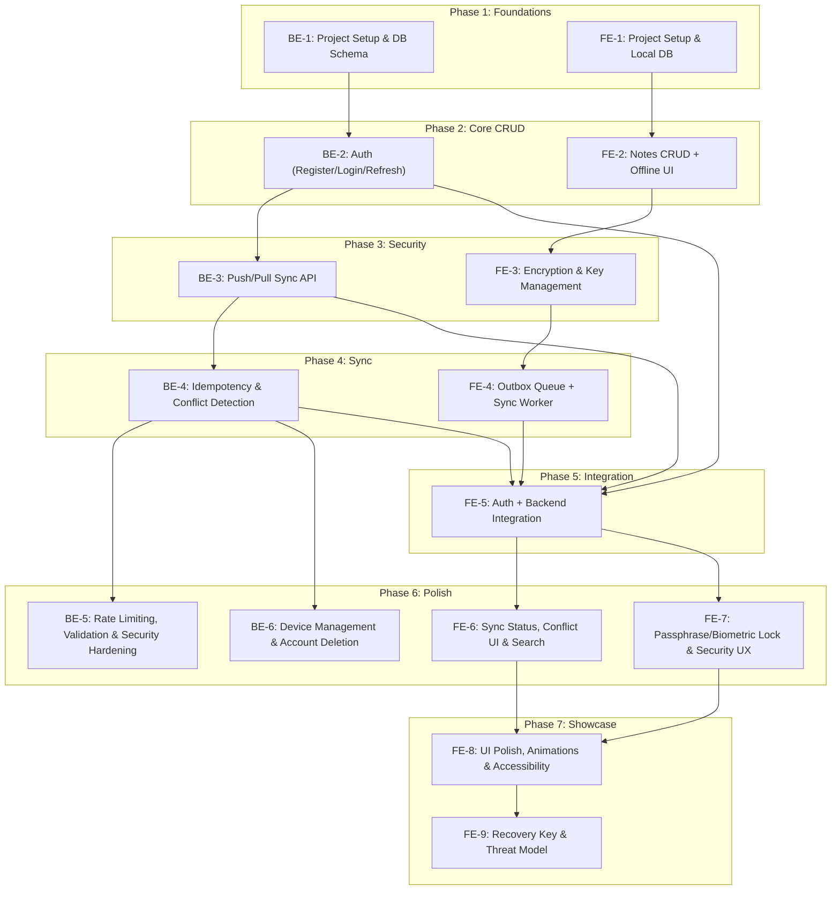

# CryptoNote – Feature Tickets & Implementation Plan

> Derived from [Crypto Note – PRD (Frontend & Backend).md](file:///d:/KotlinAps/CryptoNote/Crypto%20Note%20%E2%80%93%20PRD%20%28Frontend%20%26%20Backend%29.md)

---

## Execution Order & Dependency Map



---

# 🔵 BACKEND TICKETS (Node.js)

---

## BE-1: Project Setup & Database Schema

| Field | Value |
|-------|-------|
| **Priority** | P0 |
| **Estimate** | 1–2 days |
| **Depends On** | None |
| **PRD Refs** | B4 (Data Model), B5 (Tech Stack) |

### Description
Bootstrap the Node.js backend project and set up the PostgreSQL database with all required tables.

### Acceptance Criteria
- [ ] Project initialized with **TypeScript + Node.js**
- [ ] **Fastify** (or Express) configured with project structure: `routes/`, `services/`, `middleware/`, `db/`, `utils/`
- [ ] **Prisma** ORM configured with PostgreSQL connection
- [ ] Database schema created with these tables:

#### Tables

**`users`**
| Column | Type | Notes |
|--------|------|-------|
| id | UUID | PK, default gen |
| email | VARCHAR(255) | UNIQUE, NOT NULL |
| password_hash | TEXT | Argon2 hash |
| auth_salt | VARCHAR(128) | Per-user salt |
| created_at | TIMESTAMPTZ | DEFAULT now() |

**`notes`**
| Column | Type | Notes |
|--------|------|-------|
| id | UUID | PK |
| user_id | UUID | FK → users, NOT NULL |
| ciphertext | BYTEA | Encrypted blob |
| nonce | BYTEA | Unique per note |
| version | INT | Starts at 1, incremented on update |
| deleted | BOOLEAN | DEFAULT false (tombstone) |
| updated_at | TIMESTAMPTZ | Auto-updated |
| server_seq | BIGSERIAL | Monotonic cursor for pull |

**`processed_ops`**
| Column | Type | Notes |
|--------|------|-------|
| op_id | UUID | PK (idempotency key) |
| user_id | UUID | FK → users |
| result | VARCHAR(20) | applied / conflict / duplicate |
| created_at | TIMESTAMPTZ | DEFAULT now() |

**`devices`**
| Column | Type | Notes |
|--------|------|-------|
| id | UUID | PK |
| user_id | UUID | FK → users |
| last_seen | TIMESTAMPTZ | |

- [ ] Prisma migration runs successfully
- [ ] Seed script with test data
- [ ] Environment config (`.env.example`) for `DATABASE_URL`, `JWT_SECRET`, `PORT`
- [ ] Docker Compose file for local PostgreSQL
- [ ] Jest test framework configured

### Implementation Plan

```
1. mkdir backend && cd backend
2. npm init -y && install deps:
   - fastify, @fastify/cors, @fastify/helmet
   - prisma, @prisma/client
   - typescript, ts-node, @types/node
   - jest, ts-jest
3. Configure tsconfig.json (strict mode)
4. npx prisma init → configure schema.prisma
5. Define all 4 tables in schema.prisma
6. Add indexes: notes(user_id, server_seq), processed_ops(user_id)
7. npx prisma migrate dev --name init
8. Create folder structure:
   backend/
   ├── src/
   │   ├── app.ts           (Fastify instance + plugin registration)
   │   ├── server.ts         (entry point)
   │   ├── routes/
   │   ├── services/
   │   ├── middleware/
   │   ├── db/
   │   │   └── prisma.ts     (singleton client)
   │   ├── utils/
   │   └── types/
   ├── prisma/
   │   └── schema.prisma
   ├── tests/
   ├── docker-compose.yml
   └── .env.example
9. Create health-check route: GET /health
10. Write a basic smoke test
```

---

## BE-2: Authentication (Register / Login / Refresh)

| Field | Value |
|-------|-------|
| **Priority** | P0 |
| **Estimate** | 2–3 days |
| **Depends On** | BE-1 |
| **PRD Refs** | B1, B2 (Functional), B6 (Security) |

### Description
Implement user registration, login, and JWT token refresh. Passwords hashed with Argon2. Separate login secret from encryption passphrase (zero-knowledge).

### Acceptance Criteria
- [ ] `POST /auth/register` – accepts `{ email, password }`, returns `{ userId, accessToken, refreshToken }`
- [ ] `POST /auth/login` – validates credentials, returns JWT pair
- [ ] `POST /auth/refresh` – accepts `{ refreshToken }`, returns new JWT pair
- [ ] Passwords hashed with **Argon2id** (argon2 npm package)
- [ ] Access token expires in 15 min; refresh token in 7 days
- [ ] Refresh tokens stored hashed in DB (revocable)
- [ ] `auth_salt` generated per-user on registration and returned to client
- [ ] **Zod** validation on all request bodies
- [ ] Auth middleware extracts & verifies JWT, attaches `userId` to request
- [ ] Rate limiting on auth endpoints (5 req/min per IP)
- [ ] No sensitive data in JWT payload (only `userId`, `iat`, `exp`)
- [ ] Unit tests for register, login, refresh, expired token, invalid token

### Implementation Plan

```
1. Install: argon2, jsonwebtoken, zod, @fastify/rate-limit
2. Create schemas:
   - src/schemas/auth.schema.ts (Zod: RegisterInput, LoginInput, RefreshInput)
3. Create service:
   - src/services/auth.service.ts
     - register(email, password) → hash password, gen auth_salt, insert user, gen tokens
     - login(email, password) → verify hash, gen tokens
     - refresh(refreshToken) → verify, rotate, gen new pair
     - generateTokens(userId) → { accessToken, refreshToken }
4. Create routes:
   - src/routes/auth.routes.ts → POST /register, /login, /refresh
5. Create middleware:
   - src/middleware/auth.middleware.ts → verifyToken, attachUser
6. Add refresh_tokens table (or store hashed in users table)
7. Wire rate limiting on auth routes
8. Tests:
   - tests/auth.test.ts → happy paths + edge cases
```

---

## BE-3: Push/Pull Sync API

| Field | Value |
|-------|-------|
| **Priority** | P0 |
| **Estimate** | 3–4 days |
| **Depends On** | BE-2 |
| **PRD Refs** | B2, B3 (Push/Pull), B3 (API) |

### Description
Implement the core sync endpoints: batch push (create/update/delete operations) and cursor-based pull.

### Acceptance Criteria
- [x] `POST /sync/push` – accepts array of operations:
  ```json
  [{
    "op_id": "uuid",
    "note_id": "uuid",
    "type": "create | update | delete",
    "ciphertext": "base64",
    "nonce": "base64",
    "base_version": 0
  }]
  ```
- [x] Returns per-op result: `[{ op_id, result: "applied" | "conflict" | "duplicate", server_version }]`
- [x] `GET /sync/pull?since=<cursor>&limit=100` – returns:
  ```json
  {
    "changes": [{ "id", "ciphertext", "nonce", "version", "deleted", "updated_at", "server_seq" }],
    "next_cursor": 12345,
    "has_more": false
  }
  ```
- [x] All queries scoped by authenticated `user_id`
- [x] Push operations processed in order within a DB transaction
- [x] `create` → insert note with version=1
- [x] `update` → check `base_version` matches, increment version, update ciphertext/nonce
- [x] `delete` → set `deleted=true`, increment version
- [x] `server_seq` auto-incremented on every change
- [x] Max payload size enforced: 1 MB per note, 100 ops per push
- [x] Unit tests for: single create, batch push, pull with cursor, pull pagination

### Implementation Plan

```
1. Create schemas:
   - src/schemas/sync.schema.ts (Zod: PushOperation, PushRequest, PullQuery)
2. Create service:
   - src/services/sync.service.ts
     - push(userId, operations[]) → process each op in a transaction:
       a. Check processed_ops for op_id (→ duplicate)
       b. For create: insert note, insert processed_op
       c. For update: SELECT note WHERE id AND user_id, check version match (→ conflict), update
       d. For delete: same version check, set deleted=true
       e. Return results array
     - pull(userId, since, limit) → 
       SELECT notes WHERE user_id AND server_seq > since ORDER BY server_seq LIMIT limit+1
       → derive has_more, next_cursor
3. Create routes:
   - src/routes/sync.routes.ts → POST /sync/push, GET /sync/pull
   - Both require auth middleware
4. Add request size limit middleware (1MB per note check)
5. Tests:
   - tests/sync.test.ts → create, update, delete, pull, pagination
```

---

## BE-4: Idempotency & Conflict Detection

| Field | Value |
|-------|-------|
| **Priority** | P0 |
| **Estimate** | 2 days |
| **Depends On** | BE-3 |
| **PRD Refs** | B4, B5 (Functional), B8 (Acceptance) |

### Description
Harden the push endpoint with robust idempotency (same op_id = same result) and optimistic-concurrency conflict detection via version checks.

### Acceptance Criteria
- [ ] Same `op_id` pushed twice produces identical response, no data change
- [ ] `base_version` mismatch returns `conflict` with current server version
- [ ] Conflict response includes current `server_version` so client can resolve
- [ ] Concurrent pushes to the same note are serialized (row-level lock or serializable txn)
- [ ] `processed_ops` table cleaned up after 30 days (scheduled job or lazy)
- [ ] Integration tests:
  - Push same op_id twice → duplicate
  - Push with stale version → conflict
  - Two concurrent updates → one succeeds, one conflicts
  - Delete after delete → duplicate/no-op

### Implementation Plan

```
1. Enhance sync.service.ts push logic:
   a. First: SELECT FROM processed_ops WHERE op_id = ?
      - If found → return stored result (idempotent replay)
   b. For update/delete: SELECT ... FOR UPDATE (row lock)
      - Compare base_version vs current version
      - Mismatch → insert processed_ops with result='conflict', return conflict + current version
   c. On success → insert processed_ops with result='applied'
2. Wrap entire per-op logic in transaction (Prisma $transaction)
3. Add index on processed_ops(op_id) if not already
4. Optional: create a pg cron or application-level job to prune old processed_ops
5. Tests:
   - tests/idempotency.test.ts → replay, conflict, concurrent scenarios
```

---

## BE-5: Rate Limiting, Validation & Security Hardening

| Field | Value |
|-------|-------|
| **Priority** | P1 |
| **Estimate** | 1–2 days |
| **Depends On** | BE-4 |
| **PRD Refs** | B8 (Rate Limiting), B6 (Security) |

### Description
Add production-grade security hardening: rate limiting, input validation, helmet headers, payload logging prevention.

### Acceptance Criteria
- [ ] Global rate limit: 100 req/min per IP
- [ ] Auth endpoints: 5 req/min per IP
- [ ] Sync endpoints: 30 req/min per user
- [ ] All request bodies validated with **Zod** (reject malformed early)
- [ ] **Helmet** security headers enabled
- [ ] HTTPS-only enforcement (in production)
- [ ] Never log `ciphertext`, `nonce`, `password`, or token values
- [ ] CORS configured (restrict origins in production)
- [ ] Error responses use consistent format: `{ error: string, code: string }`
- [ ] Request ID middleware for tracing

### Implementation Plan

```
1. Configure @fastify/rate-limit with per-route overrides
2. Ensure all routes have Zod validation (review each route)
3. Add sanitized logger (redact sensitive fields from request logs)
4. Configure Helmet via @fastify/helmet
5. Add CORS plugin with configurable origins
6. Create error handler middleware with consistent error shape
7. Add request-id middleware (use crypto.randomUUID)
8. Review all error paths for information leakage
```

---

## BE-6: Device Management & Account Deletion

| Field | Value |
|-------|-------|
| **Priority** | P1 |
| **Estimate** | 1–2 days |
| **Depends On** | BE-4 |
| **PRD Refs** | B7, B9 (Functional) |

### Description
Allow users to register devices and completely delete their account (GDPR-style wipe).

### Acceptance Criteria
- [ ] `POST /devices/register` – register a device (id, push token optional)
- [ ] `GET /devices` – list user's devices with last_seen
- [ ] Device `last_seen` updated on every authenticated request (async, non-blocking)
- [ ] `DELETE /account` – permanently deletes: user, all notes, all processed_ops, all devices
- [ ] Account deletion requires re-authentication (password in body)
- [ ] Returns 204 on success
- [ ] Unit tests for device CRUD and account wipe

### Implementation Plan

```
1. Create schemas: src/schemas/device.schema.ts
2. Create service: src/services/device.service.ts
   - register(userId, deviceId)
   - list(userId)
   - updateLastSeen(userId, deviceId) [called from auth middleware]
3. Create routes: src/routes/device.routes.ts
4. Create service: src/services/account.service.ts
   - deleteAccount(userId, password) → verify password, then CASCADE delete
5. Create route: DELETE /account in src/routes/account.routes.ts
6. Tests: device registration, listing, account deletion cascade
```

---

# 🟢 FRONTEND TICKETS (Kotlin / Android)

---

## FE-1: Project Setup & Local Database

| Field | Value |
|-------|-------|
| **Priority** | P0 |
| **Estimate** | 1–2 days |
| **Depends On** | None |
| **PRD Refs** | A4 (Tech Stack), A5 (Data Model) |

### Description
Bootstrap the Android project with Jetpack Compose, Hilt DI, Room database, and the MVVM architecture.

### Acceptance Criteria
- [ ] Android project created with **min SDK 26**, target SDK 34
- [ ] **Jetpack Compose** configured with Material 3
- [ ] **Hilt** dependency injection configured
- [ ] **Room** database with these entities:

#### Room Entities

**`NoteEntity`**
| Field | Type | Notes |
|-------|------|-------|
| id | String (UUID) | PK |
| ciphertext | ByteArray | Encrypted content |
| nonce | ByteArray | Per-note nonce |
| version | Int | Default 1 |
| updatedAt | Long | Epoch millis |
| deleted | Boolean | Tombstone flag |
| syncStatus | String | `pending` / `synced` / `failed` |

**`OutboxEntity`**
| Field | Type | Notes |
|-------|------|-------|
| opId | String (UUID) | PK |
| noteId | String (UUID) | FK |
| type | String | `create` / `update` / `delete` |
| payload | String | JSON blob |
| attempts | Int | Default 0 |
| status | String | `pending` / `sent` / `failed` |
| createdAt | Long | Epoch millis |

**`SyncStateEntity`**
| Field | Type | Notes |
|-------|------|-------|
| id | Int | PK (always 1, singleton) |
| lastPullCursor | Long | Server seq cursor |

- [ ] DAOs with basic CRUD operations
- [ ] Database migration strategy set up
- [ ] Project compiles and runs with empty UI
- [ ] Package structure follows clean architecture

### Implementation Plan

```
Project package structure:
  com.cryptonote/
  ├── di/                  (Hilt modules)
  ├── data/
  │   ├── local/
  │   │   ├── db/          (Room DB, entities, DAOs)
  │   │   └── preferences/ (DataStore)
  │   ├── remote/          (Retrofit API)
  │   └── repository/
  ├── domain/
  │   ├── model/           (Domain models)
  │   ├── repository/      (Repository interfaces)
  │   └── usecase/
  ├── presentation/
  │   ├── ui/
  │   │   ├── theme/       (Material 3 theme)
  │   │   ├── notes/       (Notes list screen)
  │   │   ├── editor/      (Note editor screen)
  │   │   └── auth/        (Login/register screens)
  │   └── viewmodel/
  ├── security/            (Crypto, Keystore)
  ├── sync/                (WorkManager, sync logic)
  └── util/

Steps:
1. Create project in Android Studio or via gradle init
2. Add dependencies to build.gradle.kts:
   - Compose BOM, Material3, Navigation
   - Room + KSP, Hilt + KSP
   - Coroutines, Flow
   - Retrofit, OkHttp, Moshi/Kotlinx.serialization
   - WorkManager
3. Configure Hilt: @HiltAndroidApp, DatabaseModule, NetworkModule
4. Define Room entities, DAOs, and Database class
5. Create domain models (Note, SyncStatus enum)
6. Set up Material 3 theme (colors, typography)
7. Verify build + empty Compose screen renders
```

---

## FE-2: Notes CRUD + Offline-First UI

| Field | Value |
|-------|-------|
| **Priority** | P0 |
| **Estimate** | 3–4 days |
| **Depends On** | FE-1 |
| **PRD Refs** | F1, F2 (Functional), A7 (Non-Functional) |

### Description
Build the notes list and editor screens with full offline CRUD. All operations write to the local Room database immediately — no network required. UI updates via Flow are instant (< 100ms target).

### Acceptance Criteria
- [ ] **Notes List Screen:**
  - Displays all non-deleted notes (title preview + timestamp)
  - Pull-to-refresh gesture (triggers sync later)
  - Swipe to delete with undo snackbar
  - FAB to create new note
  - Empty state illustration
- [ ] **Note Editor Screen:**
  - Title + body text fields
  - Auto-save on back press or after debounce (2s)
  - New note creates UUID client-side
  - Shows last updated timestamp
- [ ] **Delete:** Soft-delete (tombstone flag)
- [ ] All writes go to Room → UI updates instantly via `Flow<List<Note>>`
- [ ] Local write latency < 100ms (verified with trace)
- [ ] Repository pattern: `NoteRepository` with `getAll()`, `getById()`, `save()`, `delete()`
- [ ] ViewModels use `StateFlow` for UI state
- [ ] Works entirely in airplane mode

### Implementation Plan

```
1. Create domain models:
   - Note(id, title, body, updatedAt, deleted, syncStatus)
   
2. Create NoteRepository interface + RoomNoteRepository impl:
   - getAllNotes(): Flow<List<Note>>
   - getNoteById(id): Flow<Note?>
   - saveNote(note): suspend  (insert or update)
   - deleteNote(id): suspend  (soft delete)
   Note: At this stage, store plaintext in Room.
         Encryption layer (FE-3) will wrap this later.

3. Create ViewModels:
   - NotesListViewModel: loads all notes, handles delete
   - NoteEditorViewModel: loads single note, handles save with debounce

4. Build Compose screens:
   - NotesListScreen: LazyColumn, SwipeToDismiss, FAB, EmptyState
   - NoteEditorScreen: TextField for title/body, auto-save

5. Set up Compose Navigation: list → editor (with note ID arg)

6. Wire Hilt: provide Repository, ViewModels

7. Test: create, edit, delete in airplane mode; verify instant UI updates
```

---

## FE-3: Encryption & Key Management

| Field | Value |
|-------|-------|
| **Priority** | P0 |
| **Estimate** | 4–5 days |
| **Depends On** | FE-2 |
| **PRD Refs** | F3, F4 (Functional), A3 (Security), Skills: Cryptography |

### Description
Implement the full encryption pipeline: passphrase → Argon2id → master key → HKDF split (auth key + encryption key) → per-note AES-256-GCM encryption. Keys protected by Android Keystore.

### Acceptance Criteria
- [x] **Passphrase setup flow:** First launch → set passphrase (min 8 chars)
- [x] **Key derivation:** Argon2id(passphrase, salt) → master key
- [x] **HKDF split:** master key → `auth_key` (for server login) + `encryption_key` (for notes)
- [x] **Per-note encryption:**
  - AES-256-GCM with unique random nonce (12 bytes)
  - AAD = `note_id || version` (prevents ciphertext swapping)
  - Both title and body encrypted together as a JSON blob
- [x] **Key wrapping:** Master key wrapped by Android Keystore (AES key wrap)
- [x] **Wrapped key stored in EncryptedSharedPreferences or DataStore**
- [x] **Sensitive byte arrays zeroed after use**
- [x] **CryptoManager** interface:
  - `deriveKeys(passphrase, salt): KeyPair`
  - `encrypt(noteId, version, plaintext, encKey): EncryptedNote`
  - `decrypt(noteId, version, ciphertext, nonce, encKey): String`
- [x] **Repository now encrypts before Room write, decrypts on read**
- [x] **Database dump shows only ciphertext (no plaintext anywhere)**
- [x] **Unit tests with known-answer test vectors**

### Implementation Plan

```
1. Add dependencies:
   - org.signal:argon2 (or com.lambdapioneer.argon2kt)
   - javax.crypto (built-in AES-GCM)

2. Create security/CryptoManager.kt:
   - deriveKeys(passphrase, salt):
     a. Argon2id(passphrase, salt, timeCost=3, memCost=64MB, parallelism=1) → masterKey
     b. HKDF-SHA256(masterKey, info="auth") → authKey
     c. HKDF-SHA256(masterKey, info="encrypt") → encryptionKey
     d. Return KeyPair(authKey, encryptionKey)
   
   - encrypt(noteId, version, plaintext, encKey):
     a. Generate 12-byte random nonce
     b. AAD = noteId.toByteArray() + version.toByteArray()
     c. AES-256-GCM encrypt with encKey, nonce, AAD
     d. Return EncryptedNote(ciphertext, nonce)
   
   - decrypt(noteId, version, ciphertext, nonce, encKey):
     a. AAD = noteId.toByteArray() + version.toByteArray()
     b. AES-256-GCM decrypt
     c. Return plaintext string

3. Create security/KeystoreManager.kt:
   - wrapKey(masterKey): encrypt masterKey with Keystore-backed AES key
   - unwrapKey(): decrypt masterKey from storage
   - Android Keystore alias: "cryptonote_master_key"

4. Create security/KeyStore.kt (storage):
   - Store wrapped key + salt in EncryptedSharedPreferences
   - isSetup(): Boolean
   - storeWrappedKey(wrappedKey, salt)
   - getWrappedKey(): ByteArray
   - getSalt(): ByteArray

5. Update NoteRepository:
   - save(): serialize title+body to JSON → encrypt → store ciphertext + nonce
   - getAll(): read ciphertext → decrypt → deserialize → return Note

6. Zero sensitive arrays: use `ByteArray.fill(0)` in finally blocks

7. Tests:
   - tests/CryptoManagerTest.kt → encrypt/decrypt round-trip
   - tests/KeystoreManagerTest.kt → wrap/unwrap
   - Known-answer vectors for AES-256-GCM
```

---

## FE-4: Outbox Queue + Sync Worker

| Field | Value |
|-------|-------|
| **Priority** | P0 |
| **Estimate** | 3–4 days |
| **Depends On** | FE-3 |
| **PRD Refs** | F5, F6 (Functional), A6 (Sync Behavior), Skills: Networking |

### Description
Implement the outbox pattern: every note write inserts both the note and an outbox entry in a single Room transaction. A WorkManager worker syncs the outbox when network is available.

### Acceptance Criteria
- [x] Every `save()` / `delete()` creates an `OutboxEntity` in the **same Room transaction** as the note change
- [x] Outbox entries are ordered by `seq` (strictly monotonic FIFO queue)
- [x] `SyncWorker` extends `CoroutineWorker`:
  - Runs with `NetworkType.CONNECTED` constraint
  - Pushes outbox entries in order (batched, max 50 per request)
  - On success: mark outbox entry as `sent`, update note `syncStatus = synced`
  - On failure: increment `attempts`, apply exponential backoff with jitter
  - After push: pull changes with `since=lastPullCursor`
  - Apply pulled changes to local DB (insert/update, respecting version)
  - Update `lastPullCursor`
- [x] `ConnectivityManager.NetworkCallback` triggers immediate sync on reconnect
- [x] No data loss on app kill mid-sync (WorkManager guarantees)
- [x] Survives process death and device reboot
- [x] Unit tests: outbox queuing, batch push, pull application

### Implementation Plan

```
1. Update NoteRepository.save():
   - Room @Transaction:
     a. Insert/update NoteEntity
     b. Insert OutboxEntity(opId=UUID, noteId, type, payload=ciphertext, status=pending)

2. Create sync/SyncWorker.kt (CoroutineWorker):
   - doWork():
     a. Load pending outbox entries (ORDER BY createdAt, LIMIT 50)
     b. Map to API push request
     c. Call POST /sync/push
     d. Process response:
        - applied → mark sent, set syncStatus=synced
        - conflict → mark with conflict flag (handle in FE-6)
        - duplicate → mark sent (already applied)
     e. If all sent, pull: GET /sync/pull?since=cursor
     f. Apply pulled changes to local notes table
     g. Update lastPullCursor
     h. If has_more, re-enqueue self
   - On failure: return Result.retry() (WorkManager handles backoff)

3. Create sync/SyncScheduler.kt:
   - schedulePeriodic(): PeriodicWorkRequest every 15 min with CONNECTED constraint
   - scheduleImmediate(): OneTimeWorkRequest with CONNECTED constraint

4. Create sync/ConnectivityObserver.kt:
   - Register NetworkCallback
   - On available → SyncScheduler.scheduleImmediate()

5. Wire in Hilt: SyncScheduler injected in Application.onCreate()

6. Tests:
   - Verify transaction atomicity (note + outbox)
   - Mock API responses: applied, conflict, duplicate
   - Verify pull applies changes correctly
```

---

## FE-5: Auth + Backend Integration

| Field | Value |
|-------|-------|
| **Priority** | P0 |
| **Estimate** | 2–3 days |
| **Depends On** | FE-4, BE-2, BE-3, BE-4 |
| **PRD Refs** | A4 (Retrofit/OkHttp), Skills: Networking |

### Description
Implement the auth UI (register/login screens) and Retrofit API client. Connect the sync worker to the real backend. Handle JWT refresh via OkHttp interceptor.

### Acceptance Criteria
- [x] **Register Screen:** Email + passphrase input → derives auth_key via HKDF → sends to backend
- [x] **Login Screen:** Same flow; stores tokens securely
- [x] **Retrofit API client** with endpoints:
  - `POST /auth/register`, `POST /auth/login`, `POST /auth/refresh`
  - `POST /sync/push`, `GET /sync/pull`
- [x] **OkHttp interceptor** for JWT:
  - Attaches `Authorization: Bearer <accessToken>` to all API requests
  - On 401: refresh token → retry original request
  - On refresh failure: force logout
- [x] Tokens stored in **EncryptedSharedPreferences**
- [x] TLS certificate pinning configured
- [x] gzip compression enabled
- [x] Auth state managed as a `StateFlow<AuthState>` (LoggedOut / LoggedIn / Loading)
- [x] Tests for auth flow and token refresh interceptor

### Implementation Plan

```
1. Create data/remote/ApiService.kt (Retrofit interface):
   - @POST("auth/register"), @POST("auth/login"), @POST("auth/refresh")
   - @POST("sync/push"), @GET("sync/pull")

2. Create data/remote/AuthInterceptor.kt (OkHttp Interceptor):
   - Add Bearer token to requests
   - On 401: call refresh, retry; on refresh fail: emit logout event

3. Create data/remote/CertificatePinner.kt:
   - Pin server certificate SHA-256

4. Create di/NetworkModule.kt:
   - Provide OkHttpClient with interceptor, pinner, gzip
   - Provide Retrofit instance
   - Provide ApiService

5. Create data/repository/AuthRepository.kt:
   - register(email, passphrase):
     a. Generate salt, derive keys (auth_key + encryption_key)
     b. POST /auth/register with email + auth_key (as password)
     c. Store tokens, salt, wrapped encryption_key
   - login(email, passphrase): similar flow
   - logout(): clear tokens, clear keys

6. Create presentation/ui/auth/: LoginScreen, RegisterScreen, AuthViewModel

7. Create navigation: auth flow → main notes flow (conditional on auth state)

8. Update SyncWorker: use real ApiService instead of mocks

9. Tests: auth flow, interceptor retry, token expiry
```

---

## FE-6: Sync Status, Conflict UI & Local Search

| Field | Value |
|-------|-------|
| **Priority** | P1 |
| **Estimate** | 2–3 days |
| **Depends On** | FE-5 |
| **PRD Refs** | F7, F8, F9 (Functional) |

### Description
Display sync status per note, show conflict resolution UI, and implement full-text search over decrypted notes.

### Acceptance Criteria
- [x] **Sync status indicator** per note in list: pending ⏳ / syncing 🔄 / synced ✅ / failed ❌ / conflict ⚠️
- [x] **Conflict UI:**
  - When a conflict is detected, create a copy of the note with "(conflict)" suffix
  - Show conflict badge on both copies
  - User can view both and manually merge or choose local/server versions
- [x] **Local search (in-memory zero-knowledge):**
  - Search bar in notes list
  - Decrypts notes in memory, searches title + body
  - Debounced input (300ms) with immediate keystroke responsiveness
  - Highlights matching text across title and body
- [x] Search works fully offline
- [x] Tests for conflict resolution and search (71 total Android tests passing)

### Implementation Plan

```
1. Sync Status:
   - Add SyncStatus enum: PENDING, SYNCING, SYNCED, FAILED
   - Update NoteEntity to use enum
   - Update NotesListScreen: show icon per status
   - Animate status transitions

2. Conflict Handling:
   - In SyncWorker, on conflict response:
     a. Fetch server version via pull
     b. Create local copy: Note(id=newUUID, title="(conflict) $title", ...)
     c. Mark both notes with conflictGroupId
   - Add ConflictBadge composable
   - Add "Resolve Conflict" screen showing both versions side-by-side

3. Local Search:
   - Maintain in-memory cache of decrypted notes (refreshed on Flow emission)
   - Search with String.contains() (case-insensitive) on title + body
   - Expose searchNotes(query): Flow<List<Note>> from ViewModel
   - Add SearchBar composable with debounce
   - Show "No results" empty state
```

---

## FE-7: Passphrase/Biometric Lock & Security UX

| Field | Value |
|-------|-------|
| **Priority** | P0 |
| **Estimate** | 2–3 days |
| **Depends On** | FE-5 |
| **PRD Refs** | F3, F11 (Functional), A3 (Security), Skills: OS |

### Description
Implement the app lock/unlock flow with passphrase and biometric authentication. Add security UX features like FLAG_SECURE and auto-lock.

### Acceptance Criteria
- [ ] **Unlock screen** shown on app launch (passphrase input or biometric)
- [ ] **BiometricPrompt** integration: fingerprint / face unlock
  - Falls back to passphrase if biometric unavailable
  - Biometric unlocks the Keystore-wrapped master key
- [ ] **Auto-lock** after configurable inactivity (default 5 min)
  - Zeros decryption key from memory on lock
  - Re-requires unlock
- [ ] **FLAG_SECURE** set on all note-related activities/fragments (blocks screenshots)
- [ ] **Clipboard auto-clear** after 60 seconds when note content is copied
- [ ] **Backup exclusion:** `android:allowBackup="false"`, `android:fullBackupContent="false"`
- [ ] App excluded from recent apps screenshot (FLAG_SECURE handles this)
- [ ] Tests for lock/unlock state machine

### Implementation Plan

```
1. Create security/BiometricManager.kt:
   - canAuthenticate(): Boolean
   - authenticate(activity, onSuccess, onFailure)
   - Use BiometricPrompt with CryptoObject (Keystore-backed)

2. Create presentation/ui/lock/LockScreen.kt:
   - Passphrase field + "Unlock" button
   - Biometric prompt button (if available)
   - On unlock: derive/unwrap keys, navigate to main

3. Create security/LockManager.kt:
   - isLocked: StateFlow<Boolean>
   - lock(): zero keys, set locked
   - unlock(passphrase): derive keys, set unlocked
   - startInactivityTimer(): coroutine delay → lock()
   - resetInactivityTimer(): called on user interaction

4. In MainActivity:
   - window.setFlags(FLAG_SECURE)
   - Observe LockManager.isLocked → show LockScreen overlay
   - Override onPause/onResume for auto-lock

5. Clipboard handling:
   - On copy: schedule ClipboardManager.clearPrimaryClip() after 60s

6. AndroidManifest:
   - android:allowBackup="false"
   - android:fullBackupContent="false"
```

---

## FE-8: UI Polish, Animations & Accessibility

| Field | Value |
|-------|-------|
| **Priority** | P2 |
| **Estimate** | 3–4 days |
| **Depends On** | FE-6, FE-7 |
| **PRD Refs** | F12 (Functional), Skills: UI |

### Description
Polish the UI with Material 3 design, animations, dark mode, markdown editor, and accessibility.

### Acceptance Criteria
- [ ] **Material 3 dynamic theming** (light + dark mode toggle)
- [ ] **Compose animations:**
  - Lock/unlock screen transition (fade + scale)
  - Sync status icon animation (rotate while syncing)
  - Note list item appear/disappear (AnimatedVisibility)
  - Swipe-to-delete with spring animation
- [ ] **Markdown editor** with live preview (split pane or toggle)
- [ ] **Tags:** Add/remove tags on notes, filter by tag
- [ ] **Pin notes** to top of list
- [ ] **Adaptive layout:** phone (single pane) vs tablet (list-detail split)
- [ ] **Accessibility:**
  - TalkBack content descriptions on all interactive elements
  - Large text support (sp units, scalable)
  - Contrast ratio meets WCAG AA (4.5:1 for text)
- [ ] **Empty states** and **error states** with illustrations
- [ ] Smooth 60fps on mid-range devices

### Implementation Plan

```
1. Theme:
   - Define color schemes (light + dark) in Theme.kt
   - Use dynamicColorScheme() on Android 12+
   - Add dark mode toggle in Settings

2. Animations:
   - LockScreen: AnimatedContent with fadeIn/scaleIn
   - SyncIcon: InfiniteTransition rotate animation
   - NotesList: AnimatedVisibility + fadeIn/slideInVertically
   - SwipeToDismiss: SwipeToDismissBox with spring spec

3. Markdown:
   - Use compose-richtext or custom AnnotatedString renderer
   - Toggle between edit (raw) and preview (rendered)

4. Tags & Pin:
   - Add tags: List<String> and pinned: Boolean to Note model
   - NoteEntity: tags stored as comma-separated or JSON
   - Tag chips in editor, filter chips in list header

5. Adaptive layout:
   - Use WindowSizeClass from material3-adaptive
   - ListDetailPaneScaffold for tablet

6. Accessibility:
   - Audit all composables for semantics { contentDescription = ... }
   - Verify with TalkBack
```

---

## FE-9: Recovery Key & Threat Model

| Field | Value |
|-------|-------|
| **Priority** | P1 |
| **Estimate** | 1–2 days |
| **Depends On** | FE-8 |
| **PRD Refs** | F10 (Functional), Skills: Cryptography |

### Description
Implement recovery key export/import and create a threat model document.

### Acceptance Criteria
- [ ] **Recovery key generation:** Display a 24-word mnemonic or base64 recovery key
- [ ] **Export:** User can copy/save recovery key (shown once during setup, re-viewable from settings with passphrase re-entry)
- [ ] **Import/Recovery:** Enter recovery key → derive master key → decrypt all notes
- [ ] **Threat model document** in README covering:
  - Stolen phone (at rest encryption via Keystore)
  - Malicious server (zero-knowledge, server sees only ciphertext)
  - Network sniffer (TLS + cert pinning)
  - Compromised passphrase (key wrapping, biometric as 2nd factor)
- [ ] Architecture diagram in README

### Implementation Plan

```
1. Recovery Key:
   - Generate 256-bit random recovery key
   - Encrypt master key with recovery key (AES-256-GCM)
   - Store encrypted master key blob
   - Display recovery key as base64 or BIP39 mnemonic words
   
2. Recovery flow:
   - Input recovery key → decrypt master key blob → re-wrap with new passphrase
   
3. UI:
   - RecoveryKeyScreen: display key with copy button
   - RecoveryImportScreen: input field for key
   - Accessible from Settings

4. Threat Model:
   - Add THREAT_MODEL.md to project root
   - Add architecture diagram (Mermaid or image) to README
```

---

## Summary: Recommended Build Order

| Order | Ticket | Track | Est. Days |
|-------|--------|-------|-----------|
| 1 | **BE-1** Project Setup & DB | Backend | 1–2 |
| 2 | **FE-1** Project Setup & Local DB | Frontend | 1–2 |
| 3 | **BE-2** Auth | Backend | 2–3 |
| 4 | **FE-2** Notes CRUD + Offline UI | Frontend | 3–4 |
| 5 | **FE-3** Encryption & Key Mgmt | Frontend | 4–5 |
| 6 | **BE-3** Push/Pull Sync API | Backend | 3–4 |
| 7 | **BE-4** Idempotency & Conflicts | Backend | 2 |
| 8 | **FE-4** Outbox + Sync Worker | Frontend | 3–4 |
| 9 | **FE-5** Auth + Backend Integration | Frontend | 2–3 |
| 10 | **BE-5** Security Hardening | Backend | 1–2 |
| 11 | **BE-6** Devices & Account Deletion | Backend | 1–2 |
| 12 | **FE-6** Sync Status, Conflicts & Search | Frontend | 2–3 |
| 13 | **FE-7** Passphrase/Biometric Lock | Frontend | 2–3 |
| 14 | **FE-8** UI Polish & Animations | Frontend | 3–4 |
| 15 | **FE-9** Recovery Key & Threat Model | Frontend | 1–2 |
| | **Total** | | **~30–40 days** |

> [!TIP]
> **Backend and Frontend tracks can be worked in parallel** after their respective setups (BE-1 and FE-1). The integration point is **FE-5**, where the frontend connects to the backend for the first time. Until then, frontend uses mock/local data only.
