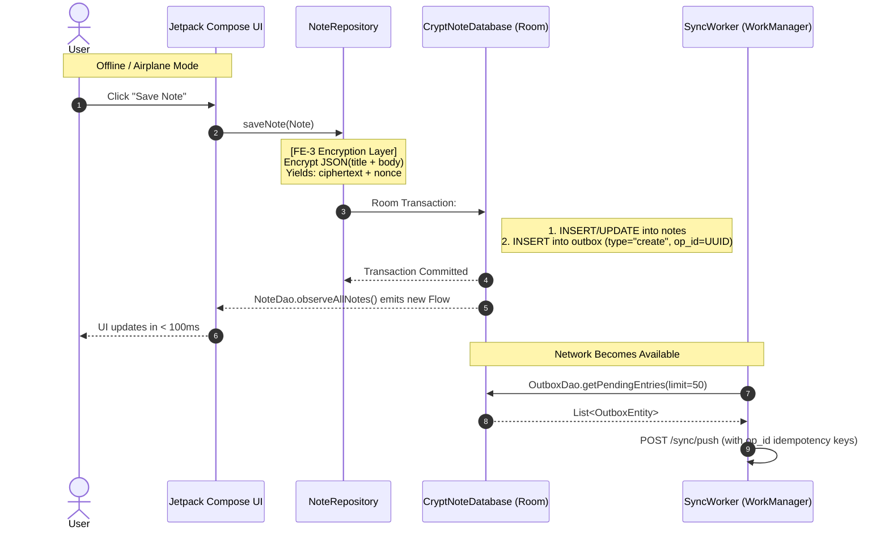

# FE-1: Project Setup & Local Database Documentation

> **Ticket:** FE-1  
> **Status:** Completed  
> **Scope:** Frontend (Android / Kotlin)  
> **App Module:** [`CryptNote`](file:///d:/KotlinAps/CryptoNote/CryptNote)  

---

## 1. Executive Summary

FE-1 sets up the architectural foundation for **CryptoNote**, an offline-first Android notes application built on zero-knowledge encryption principles.

### Core Objectives Achieved:
1. **Modern Android Foundation:** Initialized modern Kotlin (2.2.x), Android Gradle Plugin (9.x), Jetpack Compose (Material 3), and Hilt Dependency Injection.
2. **Zero-Knowledge Local Storage:** Configured a Room database with schema designed specifically for storing encrypted payloads (`ciphertext` + `nonce`), guaranteeing that no plaintext is ever stored in the SQLite database.
3. **Outbox Pattern Infrastructure:** Created an `outbox` queue table to record mutations atomically alongside note changes, enabling guaranteed, order-preserving background synchronization.
4. **Security Hardening:** Enforced zero-backup policies (`android:allowBackup="false"`) and declared necessary runtime permissions.
5. **Clean Architecture Separation:** Structured domain models and repository contracts completely decoupled from Room entities.

---

## 2. Architecture & File Structure

```
CryptNote/
├── app/
│   ├── src/main/
│   │   ├── AndroidManifest.xml                        # App config, permissions, backup rules
│   │   └── java/com/example/cryptnote/
│   │       ├── CryptNoteApp.kt                        # Hilt Application entry point
│   │       ├── MainActivity.kt                        # Annotated with @AndroidEntryPoint
│   │       ├── data/
│   │       │   └── local/db/
│   │       │       ├── CryptNoteDatabase.kt           # Room Database definition
│   │       │       ├── dao/
│   │       │       │   ├── NoteDao.kt                 # Reactive note queries & mutations
│   │       │       │   ├── OutboxDao.kt               # Outbox queue operations
│   │       │       │   └── SyncStateDao.kt            # Pull cursor management
│   │       │       └── entity/
│   │       │           ├── NoteEntity.kt              # Encrypted note table definition
│   │       │           ├── OutboxEntity.kt            # Outbox mutation queue table
│   │       │           └── SyncStateEntity.kt         # Server sequence cursor singleton
│   │       ├── di/
│   │       │   └── DatabaseModule.kt                  # Hilt providers for Room DB & DAOs
│   │       ├── domain/
│   │       │   ├── model/
│   │       │   │   ├── Note.kt                        # Plaintext domain note model
│   │       │   │   └── SyncStatus.kt                  # PENDING / SYNCED / FAILED enum
│   │       │   └── repository/
│   │       │       └── NoteRepository.kt              # Repository interface
│   │       └── ui/
│   │           └── theme/                             # Material 3 typography and colors
│   └── build.gradle.kts                               # App build script with KSP & Hilt
├── gradle/
│   └── libs.versions.toml                             # Centralized version catalog
└── build.gradle.kts                                   # Project-level build script
```

---

## 3. The "WHAT": Components Implemented

### 3.1. Version Catalog & Build System
Centralized in [`libs.versions.toml`](file:///d:/KotlinAps/CryptoNote/CryptNote/gradle/libs.versions.toml):
- **Language & Plugins:** Kotlin 2.2.10, AGP 9.2.1, KSP (`2.2.10-2.0.2`), Compose Compiler plugin.
- **Data & DI:** Room 2.8.5, Dagger-Hilt 2.56.2 (with Hilt Navigation Compose & Hilt WorkManager).
- **Network & Serialization:** Retrofit 2.11.0, OkHttp 4.12.0, Kotlinx Serialization JSON 1.8.1.
- **System & Security:** WorkManager 2.10.1, AndroidX Security Crypto, Biometric prompt.

In [`app/build.gradle.kts`](file:///d:/KotlinAps/CryptoNote/CryptNote/app/build.gradle.kts):
- Set `minSdk = 26` (Android 8.0 Oreo), required for secure crypto APIs and Keystore primitives.
- Configured Kotlin Symbol Processing (`ksp`) for both Room and Hilt instead of legacy `kapt` for 2-4x faster compilation and full Kotlin 2.x support.

---

### 3.2. Room Database Schema (Zero-Knowledge)

#### Table 1: `notes` (`NoteEntity`)
Stores notes locally. Crucially, **title and body are not stored as columns**.

| Column | Room Type | Description | Why It Exists |
| :--- | :--- | :--- | :--- |
| `id` | `String` (PK) | Client-generated UUID | Ensures offline note creation without waiting for server ID generation. |
| `ciphertext` | `ByteArray` (`BLOB`) | AES-256-GCM encrypted blob | Contains serialized JSON of `{"title": "...", "body": "..."}`. Plaintext never touches disk. |
| `nonce` | `ByteArray` (`BLOB`) | 12-byte random IV/nonce | Required for AES-GCM decryption. Generated fresh on every write. |
| `version` | `Int` | Integer counter (starts at 1) | Used for optimistic concurrency control and AAD (Additional Authenticated Data) binding. |
| `updated_at` | `Long` | Epoch milliseconds | For chronological sorting and client-side resolution. |
| `deleted` | `Boolean` | Tombstone flag (default false) | Enables soft deletion: the record is kept to propagate deletes to the server during sync. |
| `sync_status` | `String` | `"pending"`, `"synced"`, `"failed"` | Tracks synchronization lifecycle per note. |

> **Kotlin Note:** Data classes using `ByteArray` must override `equals()` and `hashCode()` using `contentEquals()` and `contentHashCode()`. Default JVM data class implementation compares byte arrays by reference, which breaks Room diffing and test comparisons.

---

#### Table 2: `outbox` (`OutboxEntity`)
Implements the **Transactional Outbox Pattern**.

| Column | Room Type | Description | Why It Exists |
| :--- | :--- | :--- | :--- |
| `op_id` | `String` (PK) | Unique UUID per operation | Serves as an **idempotency key** for the backend `POST /sync/push`. Retrying the same push never duplicates data. |
| `note_id` | `String` | Associated Note UUID | Identifies which note is being created, modified, or deleted. |
| `type` | `String` | `"create"`, `"update"`, `"delete"` | Operation discriminator. |
| `payload` | `String` | JSON payload of the operation | Holds the ciphertext, nonce, and version at the time of the operation. |
| `attempts` | `Int` | Retry attempt counter | Used by WorkManager to apply exponential backoff. |
| `status` | `String` | `"pending"`, `"sent"`, `"failed"` | State machine of the sync item. |
| `created_at` | `Long` | Creation timestamp | Enforces strict FIFO order when pushing changes to the server. |

---

#### Table 3: `sync_state` (`SyncStateEntity`)
Tracks cursor-based synchronization state.

| Column | Room Type | Description | Why It Exists |
| :--- | :--- | :--- | :--- |
| `id` | `Int` (PK) | Fixed value `1` | Singleton row guarantee. |
| `last_pull_cursor` | `Long` | Monotonic cursor (`server_seq`) | On pull, requests changes `WHERE server_seq > last_pull_cursor`, preventing redundant downloads. |

---

### 3.3. Data Access Objects (DAOs)

1. **[`NoteDao.kt`](file:///d:/KotlinAps/CryptoNote/CryptNote/app/src/main/java/com/example/cryptnote/data/local/db/dao/NoteDao.kt):**
   - `observeAllNotes(): Flow<List<NoteEntity>>` — Emits automatically whenever the database changes. Powers instantaneous UI updates (< 100ms).
   - `observeNoteById(noteId): Flow<NoteEntity?>` — Reactive single-note stream for note editor.
   - `softDeleteNote(noteId, updatedAt)` — Sets `deleted = 1` and `sync_status = 'pending'`.
   - `purgeSyncedDeletedNotes()` — Garbage-collects tombstones only after the backend confirms deletion.

2. **[`OutboxDao.kt`](file:///d:/KotlinAps/CryptoNote/CryptNote/app/src/main/java/com/example/cryptnote/data/local/db/dao/OutboxDao.kt):**
   - `getPendingEntries(limit): List<OutboxEntity>` — Ordered by `created_at ASC` to guarantee FIFO order.
   - `markAsSent(opId)` and `markAsFailed(opId)` — State transitions for the sync worker.
   - `resetFailedEntries(maxAttempts)` — Recovers transient failures with a capped retry ceiling.

3. **[`SyncStateDao.kt`](file:///d:/KotlinAps/CryptoNote/CryptNote/app/src/main/java/com/example/cryptnote/data/local/db/dao/SyncStateDao.kt):**
   - `getSyncState()` and `updatePullCursor(cursor)` — Manages the cursor bookmark.

---

### 3.4. Dependency Injection via Hilt

- **[`CryptNoteApp.kt`](file:///d:/KotlinAps/CryptoNote/CryptNote/app/src/main/java/com/example/cryptnote/CryptNoteApp.kt):** Root container with `@HiltAndroidApp`.
- **[`DatabaseModule.kt`](file:///d:/KotlinAps/CryptoNote/CryptNote/app/src/main/java/com/example/cryptnote/di/DatabaseModule.kt):**
  - Declares `@Singleton` provider for `CryptNoteDatabase`.
  - Injects `NoteDao`, `OutboxDao`, and `SyncStateDao` into any repository or worker without manual instantiation.
- **[`MainActivity.kt`](file:///d:/KotlinAps/CryptoNote/CryptNote/app/src/main/java/com/example/cryptnote/MainActivity.kt):** Annotated with `@AndroidEntryPoint` to allow injection of Hilt ViewModels in future tickets.

---

### 3.5. Security & Manifest Hardening

In [`AndroidManifest.xml`](file:///d:/KotlinAps/CryptoNote/CryptNote/app/src/main/AndroidManifest.xml):
- `android:allowBackup="false"` and `tools:replace="android:allowBackup"`:
  - **Why:** Android cloud backup (Google Drive) and ADB backup would dump the SQLite database file onto unauthenticated targets. Because keys are backed by hardware Android Keystore (which does not export to cloud backup), restoring a backup on another device would produce un-decryptable orphaned files, or if soft-keys were used, leak data. Disabling backup enforces strict zero-knowledge device boundaries.
- Permissions: `INTERNET` and `ACCESS_NETWORK_STATE` (for WorkManager network constraints), `USE_BIOMETRIC` (for upcoming biometric unlock).

---

## 4. The "WHY": Design Decisions & Trade-Offs

### 1. Why the Outbox Pattern instead of direct network calls?
- **Problem:** If a user edits a note in airplane mode or on spotty Wi-Fi, making an HTTP call directly from the UI would fail or block. If we only update the note table and later query "all pending notes", we lose the exact sequence of events (e.g., created, updated title, deleted).
- **Solution:** Writing the note update and an outbox record in **one atomic SQLite transaction** guarantees:
  1. Instant local write (< 100ms) with zero UI lag.
  2. Perfect event history.
  3. WorkManager can retry in the background without user intervention.

### 2. Why store `ciphertext` and `nonce` as raw `BLOB` rather than Base64 Strings?
- Base64 encoding expands payload size by ~33%.
- SQLite native `BLOB` storage is more compact, saves memory during deserialization, and avoids unnecessary intermediate String allocations in memory (which could linger in garbage collection heaps).

### 3. Why Client-Generated UUIDs instead of auto-increment IDs?
- Auto-increment integers require a centralized authority (the database) to assign the next ID. In an offline-first app, client A and client B would both assign `id = 1` while offline, causing collision havoc when syncing. UUIDv4 allows arbitrary offline creation with zero collision risk.

---

## 5. The "HOW": Data Flow Walkthrough



---

## 6. Verification & Readiness

| Requirement | PRD Ref | Status | Evidence |
| :--- | :--- | :--- | :--- |
| Min SDK 26 | A7 | ✅ Verified | Configured in `app/build.gradle.kts` |
| Zero Plaintext in DB Schema | A3, A8 | ✅ Verified | `NoteEntity` only has `ciphertext` & `nonce` BLOBs |
| Atomic Outbox Queue | A5, A6 | ✅ Verified | `OutboxEntity` schema matches PRD specification |
| Monotonic Pull Cursor | A5, B4 | ✅ Verified | `SyncStateEntity` with `lastPullCursor` |
| Backup Exclusion | A3 | ✅ Verified | `android:allowBackup="false"` in manifest |
| DI Integration | A4 | ✅ Verified | Hilt `@HiltAndroidApp` + `DatabaseModule` |

---

## 7. Hand-off to FE-2

With FE-1 complete:
- The database, DAOs, and Hilt modules are ready to inject.
- In **FE-2 (Notes CRUD + Offline UI)**, we will build:
  1. `NoteRepositoryImpl` (interfacing between Room and domain).
  2. `NotesListViewModel` and `NoteEditorViewModel`.
  3. Compose UI screens with LazyColumn, swipe-to-delete, and auto-save.
